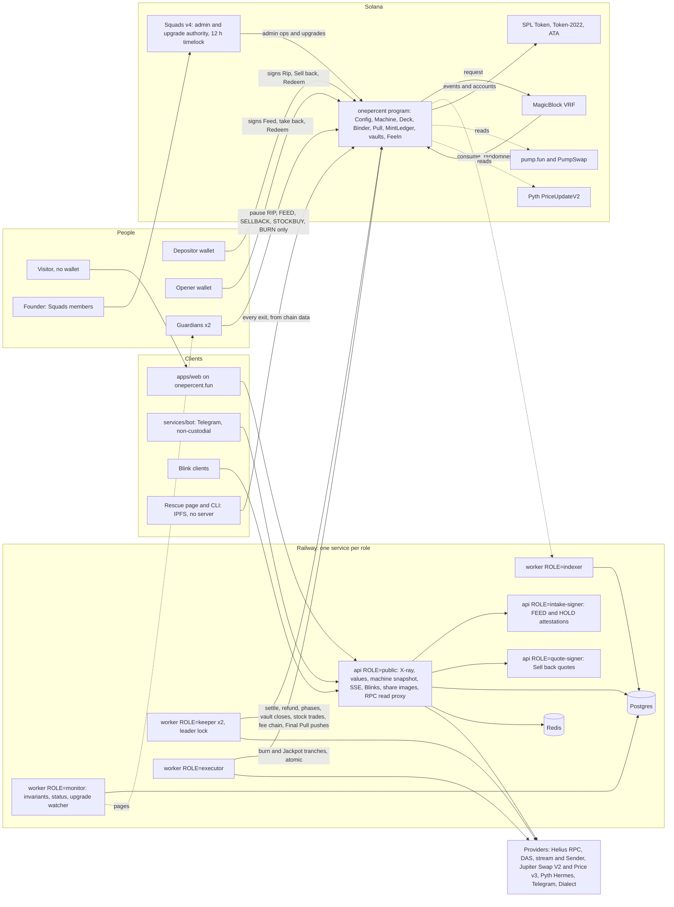
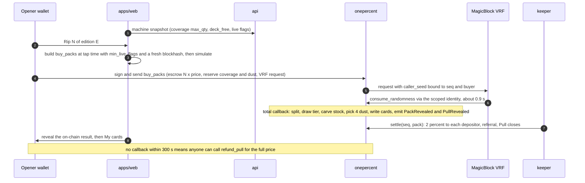
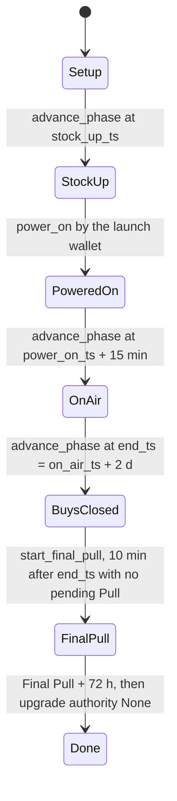
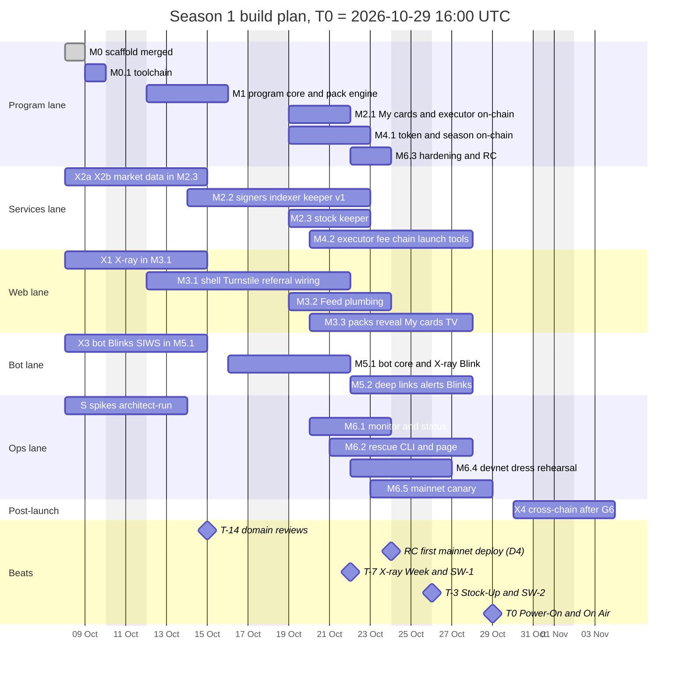

# Codex master brief: The 1% Machine, Season 1

*Issued 2026-10-08 by the architect; revised the same day, after M0 merged (PR #1) and the M1 review; re-issued the same evening with the founder's decisions D1–D11 (`DECISIONS.md`) and M2's amendments B1 and B8 folded in (changelog at the end). Codex implements one milestone at a time. The architect audits each one before the next brief is issued. This file sets the architecture, stack, environments, keys, conventions, tests, invariants and the plan, from M0 (merged) and M0.1 to launch and after. It adds no mechanic: the product is `MODEL.md`, with every number in `PARAMS.md`. The guard rails it adds are listed for founder approval in Appendix A.*

**D27, D28 and D29 amendment (2026-10-09).** `D29-METEORA-LAUNCH.md` supersedes the historical $1PCT pump launch, fee-chain and Token-2022 assumptions below. $1PCT uses SPL Token on Meteora DBC, then DAMM v2. FeeIn is the partner fee claimer and owns the permanently locked LP position; the launch wallet receives no creator trading fee. D27 sets the collection split, and D28 requires one atomic launch transaction without the two-transaction fallback. Feed and X-ray retain their pump.fun rules. D18 excludes Final Pull claims and Burn-after-Done from the launch PR and removes calendar gates.

**D29 §3b executor ownership.** M2 P1 implements the canonical DBC/DAMM v2 `sqrt_price` reference and adds `METEORA.feeAllowBps = 300` for Burn and JackpotBuy, with integer-floor math and fixture-backed Rust/SDK checks. This supersedes M2 B5's own-token 125 bps assumption; TRENDING PumpSwap reads stay unchanged. These executor changes are outside M4.1's launch and fee-collection scope.

---

## 0. Read this first

### 0.1 Authority, highest first

| # | Document | What it decides |
|---|---|---|
| 0 | `docs/codex/DECISIONS.md` | The founder's decisions log. Binding on every document below: where one of them disagrees with a decision, the decision wins |
| 1 | `docs/codex/MODEL.md` | The mechanics, as validated by the founder. Nothing may add, remove or re-theme one |
| 2 | `docs/codex/PARAMS.md` | Every number: program, services, web, bot and copy. `app/packages/config` mirrors it |
| 3 | This brief | Architecture, stack, environments, keys, conventions, tests, invariants and plan |
| 4 | The milestone or X-track brief in force (`NN-Mn-BRIEF.md`, `Xn-…-BRIEF.md`). `01-M1-BRIEF.md`, `02-M2-BRIEF.md`, `03-M3-BRIEF.md` and X1–X4 are written | The exact scope, layouts and acceptance criteria of one milestone or track |
| 5 | `docs/codex/00-M0-SCAFFOLD.md` (merged in PR #1), as migrated by M0.1 (§0.3) | Repo layout, tooling and conventions |
| 6 | `AGENTS.md`, then `docs/codex/COPY.md` (issue 1 with M3; issue 2 on D7) | Standing rules. COPY.md holds the only strings that may ship |

- The engineering spec (MODEL-SPEC v2) stays outside the repo. Every brief restates what it needs; "SPEC §x" only records provenance.
- `docs/project-context.md` describes the landing from before the pivot. For the app, `docs/codex/` supersedes it.
- When two documents disagree, or a spec is ambiguous or impossible: **stop and report with options**. Codex never decides an economic number, a mechanic, a visual or a public claim.
- **Corrections to issued briefs.** §0.5 corrects the briefs issued before this revision. A correction there wins over the brief it names, until the architect re-issues that brief with the correction folded in.
- AGENTS.md's "one milestone at a time" means **one milestone gate, or one issued X-track PR, per branch**. Parallel lanes and X tracks run only as issued (§0.4, §11.3).

### 0.2 Founder decisions recorded on 2026-10-08 (MODEL-SPEC header, `PARAMS.md` §23)

1. **All SPEC §13 changes (C1–C23) are approved**, with the recommended defaults: Sell back 87%, team seed 0 SOL, `FRESH_CAP` 25, On Air delay 15 min, The 1% divisor 1,000 SOL.
2. **Jackpot = option J-B, a continuous pre-buy.**
   - The bounded executor converts the 5% Jackpot share into $1PCT as packs sell.
   - The winner receives the whole pot at once, in $1PCT.
   - There is no "bought at the win" path, no order queue and no SOL fallback.
3. **The web work is split in two layers.**
   - **Experience layer (the architect).** The visual and UX components of `apps/web`: the machine and CRT hero, the Feed animation, the pack reveal choreography, the foil cards per tier, the Jackpot and The 1% moments, the X-ray card, the 1% TV feed and the My cards visuals. Each is self-contained, with a typed props/events interface and mock data, in the existing DA.
   - **Plumbing (Codex).** The program, services, SDK, wallet, transactions, data hooks and routing, plus the wiring of those components to real data.
   - Briefs describe the interface boundary (§2.5). They never ask Codex to design visuals.

4. **Decisions of 2026-10-08, evening (`DECISIONS.md` D1–D11), folded into this issue.** They answer Appendix A.2 and the questions the M2 and M3 briefs raised.
   - **D1 (Q1): no Spotlight in Season 1.** The RC has no `spotlight_deposit`, no `spotlight_take_back`, no Spotlight admin slot and no live Spotlight segment; the odds segment stays at width 0. Spotlight's client-side part is dropped too; M7b (the optional ZK redeem) is unaffected and stays a post-launch option.
   - **D2 (Q2): C24 = 50 bps** to the team through Relay `appFees` (`CROSSCHAIN.appFeeBps = 50`). The X4 PR merges once its own gate passes.
   - **D3 (Q3): no RC-slip fallback.** The full RC ships on schedule; if it slips anyway, the architect brings it to the founder then. The RC-slip rule is withdrawn (§11.3).
   - **D4 (Q4): no mainnet deploy of the M1 build.** The RC is the first mainnet deploy; `S` is still published at X-ray Week (§11.3).
   - **D5:** C25–C28 keep their defaults.
   - **D6:** Onepercent stays on MagicBlock's shared queue. No dedicated queue, no outreach: F6 is cancelled. The queue allow-list and the "Machine busy" occupancy guard stay.
   - **D7–D9 (X-ray):** a 54,000-slot price age for X-ray display estimates only (§7.2); `XrayResult` gains `bags[].reasonCode` and `counts.checkAtFeed`; `.sol` names are dropped for now (§0.5).
   - **D10:** M3's deviations are accepted: canonical routes `/rip`, `/cards`, `/verify/:pull` (aliases kept), the Wallet Standard packages instead of the wallet adapter, and the web lane's API under `services/api/src/web/**` with schemas in `packages/web-api` (§3.1, §3.3, §4.2).
   - **D11:** `/api/rpc` also allows `getSignaturesForAddress`, `getTransaction` and `getBlockHeight` (M2 §11.8).

**Open founder decision:** the launch date (F1, §11.7). The guard rails added by the earlier revision also need the founder's approval (Appendix A.1, items 10–15 and 17; item 16 is withdrawn by D3).

### 0.3 M0 is merged; its toolchain amendments ship as M0.1 (binding)

M0 merged on `main` on 2026-10-08 at 19:03 UTC+2 (PR #1, commit `123f70d`), built to `00-M0-SCAFFOLD.md` as issued and without the amendments below. PR #2 (`06dbb5e`) then made `pnpm typecheck` and `pnpm test` build the workspace packages first (`pnpm build:libs`). What `main` has:
- Anchor CLI and `anchor-lang` 0.32.1; Agave 2.3.0 (platform-tools 1.48, Rust 1.84.1); host Rust 1.90.0;
- `@coral-xyz/anchor` 0.32.1 with `@solana/web3.js` 1.98.4;
- no `minimumReleaseAge` and no `[workspace.metadata.cli]`;
- a `VERSIONS.md` that still reserves `ephemeral-rollups-sdk` for M1;
- 12 direct pins published less than 14 days before the merge (table in C).

**G0 is closed** as "M0 merged as issued". A–D below are delivered by one Codex PR, **M0.1 toolchain** (branch `feat/m0.1-toolchain`, gate **G0.1**, §11.4), with the exact edits of E. **M1 starts only after M0.1 is merged and S0 is recorded in `VERSIONS.md`.**

**A. Program toolchain: Solana CLI (Agave) 4.3.0 and Anchor 0.32.2, with an sBPFv3 deploy artifact.**

This supersedes the "Anchor 0.32.1" line of M0 §3, and the toolchain note at the end of `PARAMS.md` §24, which was written before this finding.

- **Why.** SIMD-0500 (feature `B8JJXCy5amZyWG9r7EnUYLwzXSXTxG7GZ1qZ1qggo83g`) makes sBPFv3 the only format accepted for deploys, upgrades and finalization.
  - Solana's upgrade page expects it on mainnet with Agave 4.4 in November 2026: during the season, or right after it.
  - A program built in an older format keeps running, but it can no longer be hot-fixed through the timelock, or sealed (upgrade authority set to None). Both are part of our safety model (§9.2 S8, M6).
- **Why 0.32.2.** Solana's page lists Anchor 0.32.2 as the minimum of the 0.32 line for sBPFv3 builds, together with Solana CLI 4.3.0. The MagicBlock crate of `01-M1-BRIEF.md` §3.1 (`ephemeral-vrf-sdk` `=0.17.3`, feature `anchor-compat`) accepts `anchor-lang >=0.28, <1.0`. Every other 0.32.x rule of M1 holds unchanged.
- **Check (G0.1).** `target/deploy/onepercent.so` must carry sBPF flags 3: `e_flags == 3`, which `readelf -h` shows as `Flags: 0x3`. `scripts/check-sbf-flags.mjs` (`01-M1-BRIEF.md` §3.1) checks it on any OS, macOS included. If `anchor build` does not produce v3 by default, pass the arch flag through to `cargo build-sbf` (`anchor build -- --arch v3`), and record the exact command in `VERSIONS.md`.
- **Verified builds.** Use `solana-verify` 0.5.2 with `[workspace.metadata.cli] solana = "4.3.0"` in `app/Cargo.toml`, and `--arch v3`.
- **One build, tested as deployed.** There is no default-arch build: every test runs the v3 artifact.
  - The Rust suite runs on `litesvm` `=0.16.0` (Agave 4.2 runtime, which executes sBPFv3; `01-M1-BRIEF.md` §3.2).
  - The TS e2e runs on npm `litesvm` 0.8.0 and on `solana-test-validator` 4.3.0 (§8.1).
  - S0 checks that `litesvm` 0.16.0 executes the v3 `.so`. If it does not, stop and report: the architect re-briefs before M1 starts. S0 also checks npm `litesvm` 0.8.0; if it cannot, the npm e2e flows move to the validator (`01-M1-BRIEF.md` §16.5 fallback).
- **Stop and report** if `ephemeral-vrf-sdk` does not build against 0.32.2, or if v3 output cannot be produced.

**B. Solana TypeScript client: `@solana/web3.js` 1.99.0 with `@anchor-lang/core` 0.32.2.**
- This closes the choice M0 §7 left open. It is the "web3.js 1.x" column of `01-M1-BRIEF.md` §3.4: `BorshCoder` from the IDL, and `litesvm` 0.8.0 for the TS e2e suite.
- **Why.** Every SDK we integrate is web3.js 1.x:
  - the wallet adapter needs `^1.99.0`;
  - Anchor's TS client pins `1.99.0`;
  - the pump.fun, MagicBlock and Squads SDKs use 1.x.
- M0 merged `@coral-xyz/anchor` 0.32.1 (the client's former package name) with web3.js 1.98.4. M0.1 moves to `@anchor-lang/core` 0.32.2, which pins web3.js 1.99.0.

**C. Dependency age.**
- Set `minimumReleaseAge: 20160` (14 days) in `app/pnpm-workspace.yaml` (pnpm 10.16 or later). It covers every npm resolution, transitive ones included.
- **Scope.** The 14-day rule binds every version named in a manifest: `package.json` dependencies and tools, `packageManager`, and every crate named in a `Cargo.toml`. Cargo has no release-age setting, so each transitive crate version that `Cargo.lock` adds or changes is listed in `VERSIONS.md` with its publish date (a generated table is fine).
- **litesvm's Agave crates.** `litesvm` 0.16.0 declares caret ranges on Agave crates (`^4.2.1`), including the `agave-unstable-api` ones, so Cargo may resolve them to 4.3.x, which is not semver-stable. If the tests then fail to compile, pin each such crate to the 4.2.x line with `cargo update -p <crate> --precise 4.2.y`, record it in `VERSIONS.md`, and report it.
- **Rust versions.** The program crate's `rust-version` becomes the Rust of the platform-tools that Agave 4.3.0's `cargo build-sbf` uses (S0 records it; M0's `1.84` matches the old 1.48 tools). The host toolchain stays 1.90.0, which `litesvm` 0.16.0 needs (MSRV 1.89). Changing it needs architect approval.
- A security release may bypass the rule only with architect approval, listed in `VERSIONS.md` with the reason.
- `VERSIONS.md` records every pin's publish date and where it was verified.
- **The 12 young M0 pins are downgraded, not exempted.** Each goes back, within its major version, to the newest release published at least 14 days before 2026-10-09 (npm registry, checked on 2026-10-08): a few patch releases, or one minor release. Five of them build the web bundle or run inside services that hold keys (`vite`, `@vitejs/plugin-react`, `hono`, `@hono/node-server`, `pino`).

| Package | Merged in M0 (published) | M0.1 pin (published) |
|---|---|---|
| `vite` | 8.3.4 (2026-10-08) | 8.3.1 (2026-09-24) |
| `@vitejs/plugin-react` | 6.1.2 (2026-10-05) | 6.1.1 (2026-08-28) |
| `hono` | 4.13.13 (2026-10-04) | 4.13.9 (2026-09-24) |
| `@hono/node-server` | 2.1.4 (2026-10-08) | 2.1.1 (2026-08-14) |
| `pino` | 10.4.0 (2026-10-02) | 10.3.1 (2026-02-09) |
| `pnpm` (`packageManager`, `engines.pnpm`) | 10.34.6 (2026-09-28) | 10.34.5 (2026-07-10) |
| `vitest` | 5.0.3 (2026-09-30) | 5.0.1 (2026-09-15) |
| `jsdom` | 30.1.2 (2026-10-04) | 30.1.1 (2026-09-22) |
| `eslint` | 10.12.0 (2026-10-02) | 10.11.0 (2026-09-18) |
| `typescript-eslint` | 8.71.1 (2026-10-05) | 8.70.1 (2026-09-21) |
| `globals` | 17.13.0 (2026-10-01) | 17.12.0 (2026-09-01) |
| `@types/node` | 22.20.5 (2026-10-01) | 22.20.4 (2026-09-19) |

If a downgrade breaks a check, or a transitive range cannot resolve without a younger version, stop and report. Only the architect can approve a `minimumReleaseAgeExclude` entry; `VERSIONS.md` then records its reason and the date it expires.

**D. Names.**
- SPEC calls the program `onepct`; in the repo it is `onepercent` (M0).
- SPEC's creator-fee instruction is named `collect_creator_fees` (`01-M1-BRIEF.md` A11).
- PDA seeds and domain tags are those of `01-M1-BRIEF.md` §6, which records its amendments A1–A18.
- Program source files follow `01-M1-BRIEF.md` §5: `constants.rs`, `errors.rs`, `events.rs`, `state/`, `math/`, `checks/`, `util/`, `instructions/`.

**E. M0.1: the exact edits.** One PR on `feat/m0.1-toolchain`. No program logic and no new package.
1. `app/Anchor.toml`: `[toolchain] anchor_version = "0.32.2"` and `solana_version = "4.3.0"`.
2. `app/programs/onepercent/Cargo.toml`: `anchor-lang = "=0.32.2"`; `rust-version` per C.
3. `app/Cargo.toml`: `exclude = ["test-programs/mock-vrf"]` in `[workspace]`, and a new `[workspace.metadata.cli]` with `solana = "4.3.0"`.
4. `.github/workflows/app.yml`, job `program`:
   - the Agave v4.3.0 release tarball;
   - avm built from tag `v0.32.2`, then `avm install 0.32.2` and `avm use 0.32.2`;
   - a new cache key naming Anchor 0.32.2 and Agave 4.3.0;
   - after `anchor build`, a step that fails unless `onepercent.so` carries sBPF flags 3: `node scripts/check-sbf-flags.mjs target/deploy/onepercent.so`, the script specified in `01-M1-BRIEF.md` §3.1, which M0.1 adds.
5. `app/package.json` and `app/packages/sdk/package.json`: `@anchor-lang/core` 0.32.2 replaces `@coral-xyz/anchor` 0.32.1, and `@solana/web3.js` moves to 1.99.0. Migrate the imports in `packages/sdk/src/index.ts` and `tests/onepercent.test.ts`, then regenerate the IDL and types (`pnpm anchor:build && pnpm sdk:idl`).
6. `app/pnpm-workspace.yaml`: `minimumReleaseAge: 20160`. Apply the downgrades of C in the manifests, then regenerate `pnpm-lock.yaml` with `pnpm install`.
7. `app/VERSIONS.md`:
   - the toolchain rows: Anchor 0.32.2; Agave 4.3.0 with its platform-tools and their Rust; `solana-verify` 0.5.2;
   - "Reserved for M1" becomes `ephemeral-vrf-sdk =0.17.3`, `default-features = false`, `features = ["anchor-compat"]`, with no `ephemeral-rollups-sdk`;
   - every new or downgraded pin, with its publish date;
   - an "S0 result" section, which the architect fills in on the M0.1 branch before G0.1.

The X tracks rebase on `main` once M0.1 merges, and regenerate `pnpm-lock.yaml` with `pnpm install`; they never hand-merge it.

**F. Founder action, now.** Codex reads briefs from `main`, where this brief and `01-M1-BRIEF.md` are not yet committed. Before the architect pushes them, with the frozen `PARAMS.md`, the founder confirms F5: Railway **Watch Paths** on the landing service ignore `app/**`, `docs/**` and `.github/**`, so these pushes do not rebuild production.

### 0.4 Milestone map

| Requested scope (in order) | Milestone | Brief |
|---|---|---|
| Scaffold | M0 | `00-M0-SCAFFOLD.md` (merged, PR #1) |
| Toolchain migration: Anchor 0.32.2, Agave 4.3.0, sBPFv3, the TS client, dependency age | M0.1 | This brief, §0.3 |
| Program core (config, vaults, Feed and Deck, take-back) **and** packs, VRF, settle, royalties | M1: one milestone, as written. It covers the on-chain core and the pack engine, plus Redeem | `01-M1-BRIEF.md` (written; corrected by §0.5) |
| My cards (Redeem, Sell back, Feed, Keep), stock keeper, hit list | M2, which also carries the first services: signers, indexer, keeper | `02-M2-BRIEF.md` |
| Web app (X-ray, Feed, crown and packs, reveal, My cards, 1% TV, fairness page) | M3: Codex builds the plumbing and wires the architect's experience components | `03-M3-BRIEF.md` with `COPY.md` |
| Token launch tooling, The 1% cards, burn and Jackpot executors, creator fees | M4, which also carries `power_on` and the Final Pull. No Spotlight in Season 1 (D1) | `04-M4-BRIEF.md` |
| Telegram bot and Blinks | M5 | `05-M5-BRIEF.md` |
| Hardening, devnet dress rehearsal, mainnet canary, launch runbook, switch-over | M6 | `06-M6-BRIEF.md` with `RUNBOOK.md` |
| Post-launch: cross-chain intake (Relay), and the optional ZK redeem (M7b, "later, unless simple") | M7 | `07-M7-BRIEF.md` |

**Reassignments.** `01-M1-BRIEF.md` §1.2–§1.3 defers these items to M2 or later, "as `00-MASTER-BRIEF.md` assigns it". This brief assigns them as follows:
- **M2:** the atomic executor core for all four kinds (StockBuy, StockSell, Burn, JackpotBuy), `sell_back`, `feed_back`, `withdraw_owed`, `close_binder` (never with a Pending Pull, §11.4), the keeper's close-vault pass, and the VRF queue-occupancy reader (API).
- **M3:** the Verify page.
- **M4:** `power_on` and FeeIn, The 1%, the Jackpot J-B win path, `collect_creator_fees`, the Final Pull, and permissionless burn after Done. No Spotlight (D1).
- **Spikes:** run by the architect (§11.4 S).

**X tracks.** Four parallel briefs were issued on D1. Each is part of a milestone above, and passes that milestone's gate for its scope:

| Track | Brief | Part of | Gate | Status |
|---|---|---|---|---|
| X1 X-ray | `X1-XRAY-BRIEF.md` | M3.1, its X-ray part | G3.1 | Issued. M3.1 still owns the real Turnstile verifier and the referral code in every share link, both live before SW-1: X1 builds the codes, the rest of M3.1 the verifier (§11.4 M3). D7–D9 apply (§0.5) |
| X2a, X2b market data | `X2-MARKET-BRIEF.md` | M2.3: value function, quotes, exit caps, listing bars | G2.3 | Issued |
| X3 bot and Blinks | `X3-BOT-BLINKS-BRIEF.md` | M5.1, plus the SIWS wallet link | G5.1 | Issued |
| X4 cross-chain | `X4-CROSSCHAIN-BRIEF.md` | M7a, its core | After G6 | Issued. No audit before G6. C24 is decided (D2, 50 bps): it merges once its own gate passes |

**Older numbering.** Briefs issued before this plan use other milestone numbers. Read them through this table until they are re-issued:

| Issued text | Where | Means |
|---|---|---|
| M3.1 (`sell_back`, the on-chain Sell back) | X2 | M2.1 |
| M3.2 (keeper stock policy, `onepct-ops hitlist`) | X2 | M2.3 |
| M4.1 (X-ray latency targets) | X1 | M3.1 |
| M4.1 (ships `packages/copy`) | X3 | M3 |
| M6, M6.2 (`/machine`, `/go/<session>` links, Backpack links, Dialect, Blink images) | X3 | M5.1, M5.2 |
| M6 (referral codes in X-ray share links) | X3 §9 | Not deferred: X1 embeds them (§11.4 M3.1) |
| M8a | X4 | M7a |
| The §0.2 table (M1.1, M1.2, M2.1, M2.2, M2.3, M3.1, `01-M1-PROGRAM-CORE.md`) | M1 | An earlier draft of this plan. M1's scope is its own §1 |
| "COPY.md, M4" | M1 §15.5 | M3 |

### 0.5 Corrections to issued briefs (binding, §0.1)

**`01-M1-BRIEF.md`:**
1. **Start.** M1 starts after M0.1 is merged and S0 is recorded in `VERSIONS.md`, not "after G0" (header, §1.4). "Every version M0 pinned (as amended)" (§2 rule 3) means the versions on `main` after M0.1.
2. **litesvm.** Do not upgrade `litesvm` during M1. The note "0.17.0 is allowed from 2026-10-12" (§3.2) is void.
3. **Top-level `feed`** (M1 A15, as written): `feed` requires `get_stack_height() == TRANSACTION_LEVEL_STACK_HEIGHT`, else `NotTopLevel`, the error appended after `NotImplemented` (§13). Test **T03.21** `feed_via_cpi_rejected` calls an otherwise valid `feed` through the mock VRF's `cpi_passthrough` (0xF3) and expects `NotTopLevel`. M2 and M4 reuse the same error for `exec_begin`, `exec_end` and `power_on` (§7.1; no `spotlight_deposit` in Season 1, D1).
4. **Mainnet feature set.** Besides T06.16, T07.11 and T08.06 (§16.1), T07.05, every T08 test, T11.01, T11.02 and the CR suites also run on mainnet's active feature set (`fixtures/mainnet/features.json`, the S0 snapshot): CU, write locks on executable or reserved payees, and rent-state rules depend on it. `VERSIONS.md` records the snapshot's slot and date.
5. **Property runs.** 1,000 cases × 200 steps in CI; 10,000 cases in the architect's gate run and in the nightly job. There is no 100,000-case run (§16.2).
6. **TS e2e and CI.** Both e2e paths of §8.1 run in the CI `program` job, as §17 lists them: `pnpm test:e2e` (npm `litesvm` 0.8.0, state injected through the SDK encoders, a ProgramData plus Program account pair included) and `pnpm e2e:validator rip` and `feed` (§16.6). If the refund flow (E3) runs on the validator (the §16.5 fallback), it starts from a pre-aged Pending Pull exported by `export_fixtures`, instead of waiting the real 300 s. The `program` job's `timeout-minutes` becomes 90.
7. **§4.1.** Item 3 (config's export map) stands; with it, and PR #2's `build:libs` before `typecheck` and `test`, a clean checkout needs no prior build. Item 5 (the TS client) is already done by M0.1: M1 only checks that `pnpm-lock.yaml` holds one version of `@solana/web3.js` (1.99.0) and of `@anchor-lang/core` (0.32.2). The flag-check script of §3.1 already exists (M0.1).
8. **Numbering.** The §0.2 table and §15.5 follow §0.4.
9. **Spotlight (D1).** The Spotlight stubs (`spotlight_deposit`, `spotlight_take_back`) keep returning `NotImplemented`, and no state ever sets the Spotlight live flag.
10. **Error copy.** §15.5's reference string for `machineChanged` ("Nothing was charged.") is void: a transaction that lands and fails still pays its network fee. `COPY.md` issue 2 holds the string.

**`X1-XRAY-BRIEF.md`:** the template ownership of §2.5; the value labels of §7.2; the referral codes, counts and Worst line of §11.4 M3.1; the numbering of §0.4. And the founder's X-ray decisions:
- **D7.** `XRAY.priceMaxAgeSlots` is 54,000 (`PARAMS.md` issue 3), for X-ray display estimates only; X1's `XRAY_PRICE_MAX_AGE_SLOTS = 54_000` stands. Every other list keeps X2's 13,500 (§7.2).
- **D8.** `XrayResult` gains `bags[].reasonCode` (public, stable codes) and `counts.checkAtFeed`. `amountUi` and `decimals` are nullable only for a not-in-set bag whose `reasonCode` is `mint_missing`, `mint_unparseable` or a failed mint-safety code.
- **D9.** `.sol` names are dropped for now (SNS's `.sol` registry migration makes resolution unreliable). The X-ray accepts wallet addresses, and `.sns` names only if they resolve; the SNS resolver stays behind a flag. `.sol` leaves the copy and the placeholders (`COPY.md` §0.5, §2). Revisit after SNS completes its migration.

**`X2-MARKET-BRIEF.md`:** the numbering of §0.4. The X2b exit cap is the cap that X1 and every list value use (§7.2).

**`X3-BOT-BLINKS-BRIEF.md`:** the numbering of §0.4. Referral codes are not deferred to "M6": X1 embeds them. The bot and the X-ray Blink show X-ray values with X1's labels (§7.2) and mirror X1's counts (§11.4 M3.1), and X1's schema with D8's fields (import it once X1 merges). **D9:** no `.sol` names: `/xray`, plain-text X-rays and the X-ray Blink take a base58 address (a `.sns` name only while X1's resolver flag is on), `{who}` is the 4+4 short address, and the START, XRAY_USAGE and Blink title texts drop "or .sol name".

**`X4-CROSSCHAIN-BRIEF.md`:** "M8a" means M7a. `CROSSCHAIN.appFeeBps` is 50, as X4 is written (D2). Acceptance 8 asserts `fee == String(appFeeBps)`. No audit before G6; it merges once its own gate passes.

**`02-M2-BRIEF.md`:** B1 and B8 are folded into §11.4 here (the quote signer ships in M2.2; M4's Final Pull claims set both claimed bits, even for a zero share). D11 is in its §11.8. `PROGRAM_IDS.pythReceiver` is in `PARAMS.md` issue 3 (§21), and PARAMS §21.1's posting rule replaces the `@pythnetwork/pyth-solana-receiver` exception of its §3, §12.3 and Appendix question 1: sponsored price accounts first, otherwise a hand-built poster, never that package. B5 is recorded in PARAMS (§8.1, §24 A17), and its §4.3 block is PARAMS §26.1.

**`03-M3-BRIEF.md`:** D10 accepts M3-A1 to M3-A3, folded into §3.1, §3.3 and §4.2 here. Its WEB section takes the values of `PARAMS.md` issue 3 §26.2 (`liveStaleAfterMs` 45,000; no `blockhashValidBlocks`). D11 removed the need for its §5.1 C fallbacks; the brief says so.

**`AGENTS.md`** now carries the value rule of §7.2 and the template ownership of §2.5. It still says "work one milestone at a time": read it as §0.1 does (one milestone per branch; parallel lanes and X tracks only as issued) until the architect updates it (A0).

**`PARAMS.md`** issue 3 (2026-10-08, evening) is in force. Besides issue 2's `close_binder` `reserved == 0`, side-effect-free attestations, estimate rule, referral codes from X-ray Week and toolchain note, it carries C24 at 50 bps and C25–C28 decided, D7's X-ray price age, `PROGRAM_IDS.pythReceiver` and the Pyth posting rule, B5's fee allowance, the `SERVICES` and `WEB` blocks, the canary in §17's up-front cash (§11.7 F14) and the first-of-coin deposit line in §19 (§11.4 M3.2). Its §27 lists every change.

**MODEL-SPEC** (outside the repo): §7.4 `close_binder` also needs no Pending Pull; §3.2 S3 and S4 record consumption only from landed Feeds (§3.3).

---

## 1. The product in one page

**Pitch.** Bags in. Packs out. Go for the 1%. A 2-day season on Solana (D37). The $1PCT token launches on Meteora DBC the same day packs go live.

**Feed (depositors).**
- A depositor feeds an eligible bag. Eligible means:
  - born on pump.fun (BondingCurve PDA checked on-chain);
  - mint and freeze authorities null;
  - Token-2022 extensions limited to metadata;
  - held at the published snapshot slot `S` (bought by swap; one transfer hop allowed);
  - one card per (wallet, mint), and at most 25 fresh cards per wallet in the Deck at a time.
- A bag is the wallet's whole balance of that coin. Its tokens move into the program vault, and the bag becomes 1 **Dust Card** in **the Deck**. Emptied token accounts are closed and their rent comes back.
- The depositor pays small refundable deposits, all shown before signing:
  - about 0.0004 SOL per Deck entry, back when the card leaves the Deck;
  - about 0.0026 SOL more for the first card of a coin the machine holds no vault for, back when that coin's vault is empty and closed (the keeper closes empty vaults at least hourly, and anyone can);
  - about 0.0012 SOL for My cards on a first Feed or Rip, back when the owner closes an empty My cards.
- When an opener pulls the card, the depositor receives **2% of that pack's price in SOL**: 0.002 / 0.005 / 0.01 / 0.02 SOL by edition. It arrives in the settlement transaction, seconds after the reveal.
- Until the card is pulled, the depositor can **take the bag back**, at any time, forever.
- A bag with a bid can be **sold** at market instead: a user-signed Jupiter swap, 100% to the user.

**Rip (openers).**
- **Editions.** The Original 0.1 SOL, Blue Shift 0.25, Signature 0.5, After Hours 1. At most 10 / 10 / 10 / 5 packs per Rip.
- **Contents.** Each pack holds **4 Dust Cards + 1 hit**.
- **Hits**, valued at the machine's stocked cost:
  - Silver Foil 0.5× (about 86%);
  - Blue Foil 1.5× (about 1 in 8.8);
  - Holo Foil 4× (1 in 50);
  - Black Foil 15× (1 in 400);
  - **Jackpot**: the whole pot, pre-bought in $1PCT. P = price ÷ 400 SOL. It is live while the SOL converted into the current pot is ≥ 15 × price;
  - **The 1%**: 10,000,000 $1PCT. P = price ÷ 1,000 SOL, ×1.5 for wallets that held ≥ 1M $1PCT for 24 h.
- **Value back.** Stock EV is exactly 72% at stocked value, and about 77% with the Jackpot. About 62.5% comes back in SOL if every foil hit is sold back, plus the Jackpot in $1PCT (`PARAMS.md` §19, C28). Dust comes on top.
- **Randomness.** MagicBlock VRF, one request per Rip; the buyer pays the 0.0005 SOL fee. Dust is picked inside the VRF callback. If no draw returns within 300 s, anyone can refund the full price.
- **Verify.** Every pull has a Verify page.

**My cards.**
- **Redeem**: tokens to the wallet. Never blockable.
- **Sell back**: Silver to Black Foil only. Instant SOL = 87% × min(stocked value, live quote), within an hourly budget. Otherwise **Sell at market**, 100% to the user.
- **Feed**: back into the Deck. Not for Jackpot, The 1% or Spotlight cards.
- **Keep.**

A token amount shown in SOL is an executable quote, "≈ X if sold now". Lists and X-ray may instead show a Price v3 estimate capped at the coin's real exit reserves, labelled "≈ X SOL est." (§7.2). Never an uncapped price × amount.

**Where hits come from (0 seed).**
- 72% of every pack goes to the **stock**. A bounded keeper buys liquid tokens from a public on-chain list:
  - MAJOR coins (WIF, BONK, POPCAT, FARTCOIN, PNUT) back every tier;
  - TRENDING coins back Silver and Blue only.
- Sold-back cards return to the stock.
- The machine only deals what it holds. An edition, or a Rip ×N, is on sale only while one MAJOR holds 15 × price free per pack being bought (coverage reservation).
- Trading fees fill the stock below the D27 floor, then follow the season split.

**Every 1 SOL of packs.** 0.72 stock · 0.08 royalties (4 × 0.02) · 0.05 Jackpot (converted to $1PCT) · 0.05 buy & burn of $1PCT · 0.02 referral (to the team if there is none) · 0.08 team. 10% of every pack buys $1PCT.

**Token.**
- The disclosed 4% dev buy (40M $1PCT) becomes the four The 1% cards. Team tokens: 0.
  - The cards are released at On Air + 0 / 12 / 24 / 36 h (D37), one live at a time.
  - Each is delivered at once when pulled.
- Trading fees go to the program's FeeIn PDA, the Meteora partner fee claimer:
  - D27: in PoweredOn or OnAir, 100% stock while the stock book is below 2 SOL;
  - at or above that floor, 50% stock / 50% team, with no stock cap;
  - from BuysClosed, 100% team, while someone runs the fee chain. The regime is read once when fees are collected. Trading fees never fund burn; the 5% pack burn is unchanged.

**Season.**
1. X-ray Week (T−7).
2. Stock-Up (T−3): Feed opens.
3. Power-On (T0): the token launches.
4. On Air (T0 + 15 min): 2 days (D37).
5. Spotlight Drops: not in Season 1 (D1).
6. Last Call: the final 6 h, with a countdown and keeper surplus sales (D37).
7. Buys close.
8. The Final Pull: everything left goes to the season's openers, pro rata to the SOL they spent on packs.
9. Sealed (Final Pull + 72 h): the upgrade key is burned.

Exits stay open forever.

**Not in v2 (never build).**
- the Common tier;
- Trade-in Credit, Assists, Final Royalties, Receipts;
- Hot or Overdue Jackpot;
- Pass or Gold Pass discounts;
- Comeback Cup, Rep, Prime Time Draw, Warm-Up Hour;
- the Globe as a SOL prize pool;
- Foreign Dust Cards;
- vesting of The 1%;
- "paid in SOL" prize copy;
- any "ZK" wording at launch.

**Non-negotiables.**
- Tokens are verified on-chain.
- Nothing a user owns can be stuck: Redeem and take-back are never blockable.
- Only literally true claims.
- A transparent launch: announced dev buy, published wallets, no hidden bundles, no fake volume.

---

## 2. Architecture

### 2.1 System

### 2.2 A Rip, end to end

### 2.3 Season phases (on-chain `Machine.phase`)

Exits work in every phase.

### 2.4 The boundary

| Where | What | Trust |
|---|---|---|
| On-chain (`onepercent`) | Everything that holds, splits, pays or decides value: vaults, Deck, cards, escrow, splits, coverage, draws, payouts, burns, the Jackpot pot, the Final Pull, phases, caps | Trustless. Odds, splits and prices are compiled into `params.rs` |
| Off-chain, bounded on-chain | FEED, HOLD and SB attestations: Ed25519, single-use, short TTL. Keeper and executor trades: atomic, top-level `exec_begin` / `exec_end` that credit only unclaimed vault slack (§7.1), on-chain `min_out`, tranche limits, minimum spacing and caps (`PARAMS.md` §8.1) | A leaked signer key can admit junk dust, grant the holder boost, or pay at most 87% of stocked value within the hourly budget. A stolen keeper or executor key never holds the machine's funds: it can cost at most `min_out` slippage per trade, within the on-chain spacing and caps, until the guardian disables it. For TRENDING coins and $1PCT, whose `min_out` reads pool reserves that key can move, only the tranche and the caps bound it. Claims never go further (AGENTS.md) |
| Off-chain only | X-ray, "≈ … if sold now" values and capped "≈ … SOL est." list values, indexing, 1% TV, notifications, share images, gathering eligibility evidence | Nothing on-chain relies on them beyond the bounds above |
| External programs | MagicBlock VRF (id pinned, queues allow-listed); pump.fun and PumpSwap (Feed and X-ray parsing); Meteora DBC and DAMM v2 ($1PCT launch, migration and fee collection); the Pyth receiver (read-only; the upgraded receiver of `PARAMS.md` §21); Token, Token-2022, ATA, System (CPI); Squads v4 (admin and upgrade authority) | D29 fee-collection CPIs target pinned Meteora programs with fixed checked accounts; no Light CPI |

### 2.5 The web boundary: experience layer and plumbing

| | Experience layer | Plumbing |
|---|---|---|
| **Owner** | The architect | Codex |
| **Location** | `app/apps/web/src/experience/`. Delivered through architect PRs (`exp/<wave>` branches). Two template files outside it are architect-owned too: `services/api/src/cards/xray-card.tsx` (X1 ships a placeholder built to the architect's spec; the architect replaces it in wave 1) and `apps/web/src/xray/XrayView.tsx` (replaced in wave 1 by the experience component with the same props) | Everything else in `apps/web` (`routes/`, `data/` for hooks, `tx/` for transaction flows, `adapters/` for chain and API data to props), plus `services/*` and `packages/*` |
| **Contents** | Machine and CRT hero; X-ray field and scan; X-ray card and share-image templates; Feed panel and animation; crown and edition panel; Rip line; reveal choreography (every tier, Turbo); foil cards; Jackpot and The 1% moments; My cards visuals; the 1% TV renderer; Verify, live and token page visuals; the Block-0 board; the Final Pull screen | Wallet connection; transaction building, signing, simulation, batching and reconciliation; data hooks; SSE; flags; routing; OG meta routes; share-image rendering; error mapping; deploy |
| **Interface** | Each component exports `Props` and `Events` types (`experience/contracts.ts`). Props are plain data: `bigint` lamports and base units, enums from `packages/config`, copy keys from `packages/copy`. Events are typed intents, for example `onRip({ edition, qty })`, `onFeed(selection)`, `onTakeBack(entryIds)`, `onRedeem(cardIds)`, `onSellBack(cardIds)`, `onSellAtMarket(cardIds)`, `onFeedBack(cardIds)`, `onVerify(seq)`, `onShare(kind)` | Codex fills `Props` from chain and API data through adapters, and answers each event with the matching flow |
| **Never** | Imports a wallet, an RPC client, the SDK or `fetch`; builds a transaction; invents a number | Edits a file under `experience/`, or one of the two template files once the architect has replaced it; restyles, re-times or re-orders a visual. A visual problem goes back to the architect as a PR comment |
| **Proof** | Mock data and a dev-only preview route (`/dev/experience`, excluded from production builds) | Integration tests that render the real components with real decoded chain data |

**Reveal rule ("no tells").**
- The reveal component receives the outcome only once the Pull is revealed on chain, decoded from `PackRevealed`.
- Every tier gets the same anticipation timing.
- Codex never passes an outcome early, and never passes a guess.

---

## 3. The `app/` workspace

### 3.1 Packages and responsibilities

| Path | Kind | Responsibility | Milestones |
|---|---|---|---|
| `programs/onepercent` | Anchor program | All value logic. Layout per `01-M1-BRIEF.md` §5: `params.rs` (generated), `constants.rs`, `errors.rs`, `events.rs`, `state/`, `math/`, `checks/`, `util/`, `instructions/` | M1, M2, M4 |
| `programs/onepercent/tests/` | Rust, LiteSVM 0.16.0 | The M1 harness (the v3 artifact, state injection, clock warp, mainnet's feature set, invariants, reference implementation), named tests, property suites, reports | M1 onwards |
| `test-programs/mock-vrf` | Native program, never deployed | Loaded at the real VRF program id, in LiteSVM and on `solana-test-validator` (`01-M1-BRIEF.md` §10.6) | M1 |
| `tests/` | TS | `anchor test` smoke tests | M0 onwards |
| `apps/web` | Vite, React, TS | Every user surface: `/`, `/x/:addr`, `/feed`, `/rip`, `/cards`, `/verify/:pull`, `/live`, `/fairness`, `/token`, `/status`; `/packs`, `/me` and `/verify/:seq` stay as permanent aliases (D10, `03-M3-BRIEF.md` M3-A1). Codex owns the plumbing; the architect owns `src/experience/` (§2.5) | M3 |
| `apps/rescue` (new) | Static page | IPFS-pinned exits UI, using chain data only | M6 |
| `services/api` | Node, 3 roles | `ROLE=public`, `ROLE=intake-signer`, `ROLE=quote-signer` (§3.2) | M2, M3, M4, M5 |
| `services/worker` | Node, 4 roles | `ROLE=indexer`, `ROLE=keeper`, `ROLE=executor`, `ROLE=monitor` (§3.2) | M2, M4, M6 |
| `services/bot` | grammY | The non-custodial Telegram bot | M5 |
| `packages/config` | TS | Every value of `PARAMS.md`, the flags and `validateParams()`. The source of the generated `params.rs` | all |
| `packages/sdk` | TS | IDL and types, PDAs, codecs, pure instruction and transaction builders, attestation messages, math mirrors, error-to-copy map (`01-M1-BRIEF.md` §15). The Verify library from M2 | M1 onwards |
| `packages/db` (new, M2) | TS | Postgres schema and forward-only migrations, shared by api, worker and bot | M2 onwards |
| `packages/copy` (new, M3) | TS | The v2 copy deck from `COPY.md`, plus the formatting helpers of DA §4.3 | M3 onwards |
| `packages/web-api` (new, M3) | TS | The zod schemas of the web lane's API routes, which live in `services/api/src/web/**` (D10, `03-M3-BRIEF.md` M3-A3, §5.1 B) | M3 onwards |
| `packages/cli` (new, M2) | TS | `onepct-ops`: Squads proposals, `initialize`, `SetSeason`, hit list, lookup table, launch script. `onepct-rescue`: every exit, from chain data | M2, M4, M6 |
| `packages/eligibility` (new, X1) | TS | Pure X-ray classification: origin, mint safety, snapshot, display values, card copy | X1 (M3.1) |
| `packages/market` (new, X2) | TS | Jupiter and Pyth clients, the value function, exit caps, the Sell back quote, listing bars | X2 (M2.3) |
| `packages/crosschain` (new, X4) | TS | Cross-chain intake | X4 (M7a), after G6 |
| `fixtures/mainnet` (new) | Data | Mainnet account dumps with slot and date: pump.fun curves, PumpSwap pools, Pyth updates, Token-2022 mints, and `features.json`, the active feature set (S0) | S onwards |

- The pnpm globs (`apps/*`, `services/*`, `packages/*`) already cover the new packages.
- `test-programs/` stays outside the cargo workspace (`exclude`, set by M0.1).

### 3.2 Deployables (Railway, one service per role, in each environment)

| Service | Code | Does | Holds | Exposure |
|---|---|---|---|---|
| `web` | `apps/web` served by Caddy | Serves the SPA. Reverse-proxies `/api/*`, `/actions.json` and `/x/*` to `api` | nothing | Public (onepercent.fun after SW-1) |
| `api` | `services/api`, `ROLE=public` | X-ray, value function, machine snapshot, SSE, transaction-builder inputs, Blinks, share and OG images, read-only RPC proxy, flags, VRF queue occupancy | No key. Refuses to boot if any `*_KEYPAIR` is set | Through `web` |
| `intake-signer` | `services/api`, `ROLE=intake-signer` | Computes the off-chain Feed checks itself (snapshot, swap provenance, one hop, one live card, not a team wallet), then signs FEED for the wallet's whole balance of each mint. Also signs HOLD. Signing changes no eligibility state (§3.3) | `INTAKE_SIGNER_KEYPAIR` | Private network only |
| `quote-signer` | `services/api`, `ROLE=quote-signer` | Gets its own Jupiter quote and signs SB | `QUOTE_SIGNER_KEYPAIR`, its own Jupiter key | Private only |
| `indexer` | `services/worker`, `ROLE=indexer` | Program events and accounts into Postgres. Feeds SSE | nothing | Private |
| `keeper-a`, `keeper-b` | `services/worker`, `ROLE=keeper` | `settle`, `refund_pull`, `advance_phase`, the close-vault pass (§11.4 M2.2), the stock policy (StockBuy and StockSell), the creator-fee chain, Final Pull conversion and claim pushes, `team_withdraw` | `KEEPER_KEYPAIR`, its own Jupiter org and RPC | Private. Leader elected by a Postgres advisory lock |
| `executor` | `services/worker`, `ROLE=executor` | Burn and JackpotBuy tranches, landed privately | `EXECUTOR_KEYPAIR` | Private |
| `monitor` | `services/worker`, `ROLE=monitor` | Invariant checks, status data, upgrade watcher, guardian paging | nothing | Status through `api` |
| `bot` | `services/bot` | Telegram | `TELEGRAM_BOT_TOKEN` only | Telegram |
| `postgres`, `redis` | Railway plugins | Durable state; rate limits and pub/sub | — | Private |
| `onepercent` (the existing landing) | Repo root | Rollback target after SW-1 | — | Kept until T0 + 7 d |

A process refuses to start when its environment contains a `*_KEYPAIR` variable that does not belong to its role.

### 3.3 API surface (v1; each milestone brief gives the exact schemas)

- **Health:** `GET /health` on every service.
- **Config:** `GET /api/config` returns the cluster, program id, flags, params hash and a phase snapshot.
- **X-ray (X1):**
  - `GET /api/xray/:addr` and `GET /api/xray/:addr/card.png?format=landscape|square`;
  - `GET /x/:addr`, the SPA shell with per-address OG meta, because unfurl crawlers run no JS;
  - `GET /api/og/*.png`, the other share and Blink images, rendered from the architect's templates.
- **Machine:** `GET /api/machine`, at most 2 s old. It carries:
  - the stock and coverage `max_qty` per edition;
  - `deck_free`;
  - the Jackpot pot (tokens and SOL cost);
  - The 1% status;
  - the phase;
  - the VRF queue occupancy.
- **Stream:** `GET /api/stream`, SSE for 1% TV and the ticker.
- **Wallet and pulls:** `GET /api/me/:wallet` and `GET /api/verify/:seq`.
- **Signer proxies:**
  - `POST /api/feed/attest` and `POST /api/hold/attest`, forwarded to the intake signer;
  - `POST /api/sellback/quote`, forwarded to the quote signer;
  - **Attestations have no side effects on eligibility.** The intake signer reads chain and indexer state and signs; apart from its log, it writes nothing. The (sender, mint) pairs consumed by one-hop provenance (SPEC S3) and the one-live-fresh-card state (S4) are written only by the indexer, from landed `BagFed` events. So a request made for someone else's wallet can never use up its eligibility. The Feed Blink POST goes through the same path;
  - attestation requests are rate-limited per requested wallet and per IP (`INTAKE.rateLimitPerMinutePerWallet` 30, `INTAKE.rateLimitPerMinutePerIp` 60, `PARAMS.md` §6.2);
  - two attestations issued for one provenance within one TTL (120 s) can both land. The cost is at most one extra card, and it is accepted.
- **Value function:** `GET /api/value?mint=&amount=`.
- **RPC:** `POST /api/rpc`, a read-only proxy with a method allow-list (`02-M2-BRIEF.md` §11.8). It includes `getSignaturesForAddress`, `getTransaction` and `getBlockHeight`, which Verify and the expiry check need (D11). The browser never holds an RPC key.
- **Web lane (M3, D10):** `POST /api/values`, `GET /api/logo/:mint`, `GET /api/web/config`, `GET /api/swap/sell`, `POST /api/send`, `GET /api/events`, `GET /api/highlights`, `GET /api/royalties/:wallet` and `POST /api/beacon`, under `services/api/src/web/**`, with schemas in `packages/web-api` (`03-M3-BRIEF.md` §5.1 B).
- **Blinks:** `GET /actions.json` and `GET|POST /api/actions/{xray, rip/:edition, feed/:mint, highlight/:seq}`. Actions CORS and headers apply on these routes only.
- **Wallet link (X3):** `/api/link/*` and the web page `/link/:nonce`, signed in with SIWS.
- **Status:** `GET /api/status`, the degraded-modes matrix with live health.

### 3.4 Data

- **Postgres** (`packages/db`):
  - raw chain events keyed by (signature, instruction index);
  - mirrors of pulls, cards and the Deck;
  - royalties and feeds;
  - intake evidence, and the consumed (sender, mint) pairs, written by the indexer from landed `BagFed` events only;
  - attestation and quote logs;
  - the X-ray cache;
  - wallet ↔ Telegram links (SIWS), referral aliases, alert subscriptions;
  - $1PCT transfers, for the holder attestation and the Block-0 board;
  - keeper jobs and hit-list reports.
- **Redis:** rate limits, SSE pub/sub, short caches.
- **The chain is the source of truth.** Every row can be rebuilt by replaying the chain.

---

## 4. Pinned stack

### 4.1 Rules

- Lockfiles pin exact versions (M0 §1 rule 4), with the 14-day age rule (§0.3 C). `VERSIONS.md` is the record.
- A milestone brief may pin more precisely, as `01-M1-BRIEF.md` §3 does, and it wins inside its scope. §0.3 A–C are binding.
- §4.2 records the versions on `main` after M0.1. For a package already installed, the lockfile on `main` wins: a row that disagrees with it is a documentation error, to report in the PR, never a reason to switch. For a package not yet installed, the row is the pin; if it cannot be installed as written, stop and report.

### 4.2 Pins (verified on 2026-10-08; sources in Appendix B)

| Area | Pin | Published | Why |
|---|---|---|---|
| Solana CLI (Agave) | 4.3.0 | 2026-09-18 | Builds sBPFv3 (SIMD-0500). Its `solana-test-validator` runs M0's smoke test and the validator e2e (§8.1) |
| Anchor CLI (avm), `anchor-lang`, `anchor-spl` | 0.32.2 | 2026-09-14 | The 0.32 line with sBPFv3 (§0.3 A). `anchor-spl` features per `01-M1-BRIEF.md` §3.1 |
| MagicBlock | `ephemeral-vrf-sdk` `=0.17.3`, `default-features = false`, `features = ["anchor-compat"]`. No `ephemeral-rollups-sdk` | 2026-09-24 | `anchor` maps to `anchor-modern` (anchor-lang 1.x); `anchor-compat` accepts `<1.0`. Verified on crates.io. This supersedes the MagicBlock line of M0 §3 and the "Reserved for M1" note of M0's `VERSIONS.md` |
| Rust test crates | `litesvm =0.16.0` (feature `precompiles`), `proptest =1.11.0`. The `solana-*` test crates at exactly the versions `litesvm` 0.16.0 resolves in `Cargo.lock`. No `litesvm` upgrade during M1 | 2026-08-24, 2026-03-24 | `01-M1-BRIEF.md` §3.2 is authoritative. Agave 4.2 runtime, so the suite runs the v3 artifact (S0 checks it); solana 3.x/4.x types, bridged to Anchor's 2.x types by `tests/common/conv.rs`. MSRV 1.89 |
| Mock VRF | `solana-program =2.3.0`, `borsh 0.10` | — | Native, never deployed |
| Pyth, on-chain parsing | `pyth-solana-receiver-sdk` 1.2.0 (feature `pro-compatible`) or a hand parser (`02-M2-BRIEF.md` §6.4). The receiver is the upgraded `rec2HHDD…` (`PARAMS.md` §21) | 2026-05-19 | 1.2.0 needs `anchor-lang ^0.32.1`. 2.0.0 needs `^1.0.2`: excluded |
| `solana-verify` | 0.5.2 | 2026-09-21 | Verified build hash with `--arch v3` |
| Node.js | 22 LTS: `engines` `>=22.22.2 <23`, as merged | — | M0 rule. `jsdom` 30 needs 22.22.2. `.nvmrc`, CI and Docker track the 22 line |
| pnpm | 10.34.5 (M0.1; M0 merged 10.34.6, younger than 14 days) | 2026-07-10 | `minimumReleaseAge` needs 10.16 or later |
| TypeScript | 5.9.3 | 2025-09-30 | `typescript-eslint` 8.x supports TypeScript below 6.1 |
| Solana TS | `@solana/web3.js` 1.99.0, `@anchor-lang/core` 0.32.2, `@solana/spl-token` 0.4.15, `litesvm` (npm) 0.8.0 | 2026-09-08, 2026-09-14, 2026-07-09, 2026-05-20 | §0.3 B; M0.1 replaces M0's `@coral-xyz/anchor` 0.32.1 and web3.js 1.98.4. npm `litesvm` 1.x is built on `@solana/kit` and is not used |
| Wallet | `@wallet-standard/app`, `@wallet-standard/base`, `@wallet-standard/features` 1.1.1; `@solana/wallet-standard-features` 1.5.0 (X3's pins) | 2026-06-03; 2026-09-10 | D10: the Wallet Standard packages, not the wallet adapter. Discovery and multi-input `solana:signAndSendTransaction`, so the approval count shown is true: Phantom, Solflare, Backpack. No `@solana/wallet-adapter-*` package. The wallet UI is the architect's |
| Squads | `@sqds/multisig` 2.1.4 | 2025-06-16 | Proposals from `onepct-ops` |
| Pyth, off-chain | No Pyth SDK: Hermes over REST with zod-typed `fetch` (X2's client) | — | Display prices, and the keeper's hand-built poster for stale or unmaintained feeds (`PARAMS.md` §21.1). `@pythnetwork/pyth-solana-receiver` 0.16.0 is not used: it depends on `@coral-xyz/anchor ^0.29`, which §0.3 B excludes. Hermes needs an API key |
| pump.fun | Instructions built from the live interface verified in S1 | — | `@pump-fun/pump-sdk` only at a version at least 14 days old that matches the live program (2.0.0 is the newest eligible today). 3.0.0 → 4.0.0 appeared on 2026-10-07/08 and are not used without review |
| Jupiter, Helius | REST and JSON-RPC through zod-typed `fetch`; no SDK | — | Swap V2 `/order` and `/build`, Price v3, Tokens v2. DAS, Enhanced Transactions, LaserStream or webhooks, Sender |
| HTTP server | Hono 4.13.9 with `@hono/node-server` 2.1.1: M0's choice, at the M0.1 versions | 2026-09-24, 2026-08-14 | Handles SSE |
| Services | `zod` 4.6.5, `pino` 10.3.1 (M0.1), `grammy` 1.46.0. Postgres 17 with `drizzle-orm` 0.45.3, `drizzle-kit` 0.31.11, `pg` 8.23.0. Redis 7 | 2026-02-09 to 2026-09-21 | Forward-only migrations |
| Share images | `satori` 0.33.5, `@resvg/resvg-js` 2.6.2 | 2026-09-22, 2024-03-26 | satori published 0.34 → 0.44 between 2026-10-02 and 2026-10-08. Keep the newest release that is at least 14 days old |
| Web | React 19.3.0, Vite 8.3.1 with `@vitejs/plugin-react` 6.1.1 (M0's major, at the M0.1 versions), three 0.180.0 with `@types/three` 0.180.0, gsap 3.15.0 (experience layer, added by the architect's waves; `PARAMS.md` §26.4), `@fontsource/fraunces` and `@fontsource/dm-sans` 5.3.0 | 2026-09-09, 2026-09-24, 2026-08-28, 2025-09-03, 2026-04-13, 2026-07-19 | three and the fonts match the landing's lockfile, so the ported CRT behaves the same. Vite stays on the major M0 merged; the architect checks the CRT port in wave 1 |
| Tests | Vitest 5.0.1 and `jsdom` 30.1.1 (M0.1), `fast-check` 4.10.2, `@playwright/test` 1.63.0 | 2026-09-15, 2026-09-22, —, — | — |
| Lint and types | `eslint` 10.11.0, `typescript-eslint` 8.70.1, `globals` 17.12.0, `@types/node` 22.20.4 (M0.1); `@eslint/js` 10.0.1, `prettier` 3.9.9, `tsx` 4.23.15 (as merged) | 2026-02-06 to 2026-09-23 | M0's tools |
| Post-launch | M7a (X4): no Relay SDK; Relay over REST with zod-typed `fetch`, and one `viem` version, at least 2.55.0 (`X4-CROSSCHAIN-BRIEF.md` §1, §13). M7b: `@lightprotocol/stateless.js` and `@lightprotocol/compressed-token` 0.23.3 | — | Pinned when the milestone starts, at least 14 days old |

### 4.3 External ids

`01-M1-BRIEF.md` §6.1 is the reference: MagicBlock VRF, its queues and the legacy identity (to reject), pump.fun, the token programs, wSOL, Ed25519, Instructions and Memo. It adds:

| Program or account | Id |
|---|---|
| PumpSwap | `pAMMBay6oceH9fJKBRHGP5D4bD4sWpmSwMn52FMfXEA` |
| pump fees | `pfeeUxB6jkeY1Hxd7CsFCAjcbHA9rWtchMGdZ6VojVZ`. S1 confirms the creator-fee chain accounts |
| Squads v4 | `SQDS4ep65T869zMMBKyuUq6aD6EgTu8psMjkvj52pCf` |
| Pyth receiver | `rec2HHDDnjLfj4kE7VyEtFA1HPGQLK33259532cRyHp`, the upgraded receiver (`PARAMS.md` issue 3, §21). Push oracle `pyt2F414BA6dPttK6RddPZUdHfapoBN24GL5wbrPCou` and Wormhole receiver `HDw2E7P8X1SkCyjvoGsfBGAVUutKcj874bXjHrpVYrVL`, off-chain only |
| Light compressed-token | `cTokenmWW8bLPjZEBAUgYy3zKxQZW6VKi7bqNFEVv3m` (M7b only) |

Never pin MagicBlock's ProgramData address or deploy slot.

---

## 5. Environments

### 5.1 Matrix

| | localnet | devnet | mainnet canary | mainnet |
|---|---|---|---|---|
| Purpose | Unit, program and property tests; local development | Real MagicBlock VRF; services and e2e; dress rehearsal | Real integrations at tiny size, team only; VRF burst test; launch rehearsal | Production |
| Chain | LiteSVM in-process; `solana-test-validator` 4.3.0 | Solana devnet | Solana mainnet | Solana mainnet |
| Program build | Same source and same constants everywhere; only `declare_id!` differs per cluster | Devnet program id | Canary program id | Mainnet program id, verified hash |
| VRF | The mock VRF at the VRF id (`01-M1-BRIEF.md` §10.6) | MagicBlock devnet or test queue (S2) | MagicBlock mainnet queue | The shared queue `Cuj97…`, allow-listed (D6) |
| pump.fun | Fake BondingCurve accounts (M1 harness) and mainnet fixtures | Real programs if S1 finds them on devnet. Otherwise Feed and Rip e2e run on `solana-test-validator` 4.3.0 with pump.fun accounts cloned from mainnet and the mock VRF, and devnet keeps VRF-only checks | Real | Real |
| Jupiter | Recorded responses | Stub quotes; a test transfer stands in for the swap between `exec_begin` and `exec_end` | Real | Real |
| Pyth | Fixtures | Devnet accounts (S4) | Real | Real |
| Season-end flows | Clock warp and state injection | Not reached in the launch rehearsal (2-day clock, D37) | Reached 2 days after its On Air | Real |
| Services | Local processes; Postgres and Redis via docker compose | Railway `dev` | Railway `staging` | Railway `production` |
| Web | localhost | Railway domain | `staging.onepercent.fun` behind basic auth | `onepercent.fun` after SW-1 |
| Telegram | Dev bot | Dev bot | Staging bot | "1% Machine" |

- The program crate has no custom cargo feature, no mock and no test path (`01-M1-BRIEF.md` §2.8). The mainnet and canary binaries differ only by program id.
- The canary's Power-On rehearsal therefore needs the real 40M-token dev buy, on a throwaway coin: about 1.2 SOL. It is recovered after the canary's own Final Pull, by redeeming the tokens and selling them back on the curve.
- The canary is a second program, with its own rent: about 2.6 SOL for about 500 KB at 5,080 lamports per byte, plus an equal temporary deploy buffer. In all it locks about 3.9 SOL, plus about 2.6 SOL of buffer during the deploy and fees (F14). Its upgrade authority is never set to None, so the program can be closed after its season and the rent recovered.

### 5.2 Railway environments, domains and deploys

- **Environments.** Three: `dev` (devnet), `staging` (mainnet canary) and `production`. Each runs the service set of §3.2.
- **Deploys.**
  - `dev` auto-deploys from `main`.
  - `staging` and `production` deploy from the branch `release`. The founder fast-forwards it after an audit PASS.
  - Production promotion is manual.
  - Every app service has Watch Paths limited to its own package and the shared packages.
- **Build-context trap.**
  - The root `.dockerignore` belongs to the landing and whitelists only landing files.
  - App services build with Railway Root Directory = `app`, and their own ignore files.
  - The web image also needs the landing's CRT and pack assets. M3 provides them without editing any landing file and without duplicating binaries in git: either a Dockerfile-specific ignore file with the repo root as context, or a build-time copy. This is verified on Railway before SW-1.
- **Cloudflare** sits in front of `web`: Turnstile, CDN, and SSE without buffering.

### 5.3 Switch-over (landing → app)

| Stage | When | Change | Rollback |
|---|---|---|---|
| SW-1 | T−7 (D11, X-ray Week) | Railway moves the custom domains `onepercent.fun` and `www` from the landing service to `web`. `XRAY` on; TV countdown | Move the domains back (≤ 5 min, rehearsed) |
| SW-2 | T−3 (D13, Stock-Up) | `FEED` on, once the program is in `StockUp` | Flag off; exits stay visible |
| SW-3 | T0 + 15 min (On Air) | `PACKS` and `SELL_BACK` on | Flag off; the guardian can pause RIP |

- No landing file is modified at any stage.
- The landing service is deleted at T0 + 7 d.

---

## 6. Secrets and keys

| Key | Kind and location | Held by | Can | Cannot | Rotation |
|---|---|---|---|---|---|
| Squads v4 members ×3 | Hardware wallets, offline | Founder side, 3 separate devices | 2-of-3 with a 12 h timelock: `admin_config`, `admin_list_mint` and upgrades | Act without the timelock | Squads config change (timelocked) |
| Guardians ×2 | Single keys on separate machines, two time zones | Founder and one trusted operator | Set the five pause bits; disable a bucket or a role key; lower a cap; switch among allow-listed VRF queues | Touch an exit; grant anything; unpause what an admin disabled | Admin rotates |
| Program id keypairs (mainnet, canary, devnet) | Offline, encrypted | Founder | First deploy only | — | — |
| Deployer (upgrade authority before the RC) | Operator machine | Founder | Deploy and upgrade until the authority moves to Squads, before Stock-Up | Anything after that move | Retired at that move |
| $1PCT vanity mint keypair | Offline until T0 | Founder | Create the mint once, in the launch transaction | — | Single use |
| Launch wallet | Operator machine at T0, funded from the multisig | Founder | `power_on`, once | Anything after Power-On. It ends holding 0 $1PCT | Dead after T0 |
| Keeper | Hot key, `keeper-*` env only | Ops | StockBuy and StockSell within on-chain bounds; permissionless calls | Move value outside an atomic pair | Admin rotates (12 h); the guardian disables at once |
| Executor | Hot key, `executor` env only | Ops | Burn and JackpotBuy tranches | Same | Same |
| Intake signer | Hot key, `intake-signer` env only | Ops | Sign FEED and HOLD | Move funds | Same |
| Quote signer | Hot key, `quote-signer` env only | Ops | Sign Sell back quotes | Pay above 87% of stocked value, or beyond the hourly budget | Same |
| Team wallet | Squads vault | Founder side | Receives `team_withdraw` | — | — |
| Provider secrets: Telegram token; Helius keys (one per service); Jupiter keys (one org for the API and the quote signer, another for the keeper); Pyth Hermes key; Turnstile; Relay (M7a) | Railway variables of the service that uses each | Ops | — | Reach the browser | Rotate in the provider's dashboard |
| Devnet deployer | GitHub Actions secret | CI | Devnet deploys (manual dispatch) | — | Free to rotate |

**Rules.**
1. No key in git, ever. `.env.example` lists names only. Local development uses gitignored `.env.local` files. Tests generate their keypairs at runtime.
2. CI holds no mainnet key. Mainnet operations are `packages/cli` scripts that the founder runs from an operator machine, following `RUNBOOK.md`. Neither Codex nor the architect sends a mainnet transaction.
3. Each hot key lives in exactly one service. A service refuses to boot with another role's key. Keys are never logged and never sent between services.
4. A signer computes what it signs. It never signs a number a client supplied.
5. Dev, staging and production keys are distinct.
6. Every role address and every vault is published at Power-On.
7. Users sign their own transactions. Nothing asks for, receives, stores or derives a private key or a seed phrase.

---

## 7. Conventions

### 7.1 Program

- `01-M1-BRIEF.md` sets the conventions for every program milestone. Later briefs extend them; they never change them.
  - §2: rules;
  - §5: layout;
  - §6: ids, PDAs, codes, domains, sizes;
  - §7: account layouts;
  - §8: helpers;
  - §12–§13: events and errors.
- **Parameters.** Every economic number flows from `packages/config` into the generated `params.rs`, and CI fails on drift (`01-M1-BRIEF.md` §4.3). Sizes, seeds, ids and enum codes live in `constants.rs`.
- **Top-level only.** The instructions sysvar lists only top-level instructions, so every rule that reads it (H4, the single-feed rule, the executor pairing) binds only a top-level caller.
  - `feed`, `exec_begin` and `exec_end`, and later `power_on`, require `get_stack_height() == TRANSACTION_LEVEL_STACK_HEIGHT`, else `NotTopLevel` (appended at the end of the error list by M1).
  - Admin and guardian instructions stay CPI-callable, because Squads executes them by CPI. Exits stay CPI-callable.
  - **Why.** Without this rule, a stolen keeper key could put its own program in the "swap" slot between `exec_begin(StockBuy)` and `exec_end`, move tokens to the vault with a top-level transfer, and CPI `feed` with them. The same tokens would then count both as a deposit and as stock: the key keeps 5 SOL per transaction, and the coin's vault owes more than it holds (I1 broken), so its last holders could never be paid.
- **Credit only unclaimed slack.** Every instruction that credits a measured vault delta Δ to `ledger.accounted`, or burns it, first requires `vault.amount − ledger.accounted ≥ Δ` (≥, never ==): `feed` (H4), `exec_end` for StockBuy and JackpotBuy (before `accounted += Δ`) and for Burn (before `burn_checked(Δ)`), and `power_on`. (There is no `spotlight_deposit` in Season 1, D1.)
- **`mint_is_safe`** runs in `feed` and `admin_list_mint` (M1), then in `power_on` on `Config.token_mint`, StockBuy and `sell_back` (M2, M4). Never in an exit or the callback.
- **Arithmetic.**
  - Entry instructions use checked arithmetic and return `MathOverflow`.
  - Exits and the callback saturate and have no arithmetic error path.
  - No `unwrap`, `expect`, `panic!`, unchecked indexing, failing `as` casts or floating point.
- **Balances.** Compare with `≥` against tracked amounts, never `==` on lamports or token amounts. Never pay out `lamports − rent`. Rent always comes from the `Rent` sysvar.
- **`consume_randomness`.**
  - The `#[vrf_callback]` scoped-identity constraint is its only `Err` path.
  - It touches its four accounts only, makes no CPI and creates no account.
  - On a mismatch or a stale state it returns `Ok` and emits `CallbackSkipped`.
- **Time.** Use `Clock::unix_timestamp` in seconds. Never count slots for a duration.
- **Pause bits** are read only by `buy_packs`, `feed`, `feed_back`, `sell_back` and `exec_begin`.
- **Errors** are append-only: a new milestone adds at the end and never renumbers. M1 appends `NotTopLevel` after `NotImplemented`.
- **Events.** Every state change emits one. The indexer also reconciles from account state, so a truncated log never loses data.

### 7.2 Money and math

- Lamports and base units are `bigint` in TS and `u64` on-chain. bps and ppb are integers.
- Rounding follows `PARAMS.md` §16.4. The TS mirrors use the same integer formulas, tested against the Rust golden vectors.
- Values follow `PARAMS.md` §18: an executable quote capped at real reserves, labelled "≈ … if sold now", or "—".
- **The one exception: lists and X-ray.** Lists, X-ray, and what reuses X-ray results (share cards, bot replies, the X-ray Blink) may show a Price v3 estimate instead, under three conditions:
  - it is capped at the coin's real exit reserves, `min(estimate, floor(realQuoteLamports × (10_000 − feeBps) / 10_000))`, the X2 exit cap (`getExitCap`), for live curves **and** canonical PumpSwap pools;
  - no readable cap means no value, and so does a price older than `XRAY.priceMaxAgeSlots` (54,000 slots, D7) in the X-ray and what reuses its results, or older than X2's `MARKET.price.maxAgeSlots` (13,500 slots) in every other list;
  - it is labelled "≈ … SOL est.".
- "If sold now" always means an executable quote (X2 `valueNow`). Nothing else carries that label.

### 7.3 TypeScript services

- `strict`, ESM, Node 22.
- zod on every boundary: env, HTTP in and out, external API responses, DB JSON.
- pino JSON logs, never with a secret.
- Graceful shutdown and `/health` on every service.
- Keeper and executor actions are idempotent, keyed, deduplicated by signature, and retried with jittered backoff.
- Provider calls have timeouts and per-provider circuit breakers. Each service has its own Helius key.
- The chain is the truth.

### 7.4 Web (plumbing side)

- Respect the boundary of §2.5.
- Every number reaching a component comes from one of:
  - the chain, or an `/api` snapshot of chain state;
  - `packages/config`;
  - a labelled value-function quote, or a capped and labelled list estimate (§7.2).
- "On air" is passed as `true` only while data actually flows.
- Trust lines (timelock, multisig, seal date) are passed only when chain state makes them true: read the upgrade authority and the Squads config.
- No RPC key, secret or private endpoint in the bundle. Strict CSP. The only third-party script is Turnstile.

### 7.5 Transactions and signing

- **Building.** Transactions are built in the client at tap time with a blockhash fetched at `confirmed`, then simulated before the wallet prompt. They are rebuilt when the blockhash expires. The one exception is a Blink POST: the server builds the transaction, as the Actions spec requires.
- **Format.** Every transaction a wallet signs is legacy or v0, at most 1,232 B, with 15% headroom (1,047 B for Feed). Keeper and executor transactions also use v0 with lookup tables, unless a brief says otherwise.
- **Feed transactions:**
  - a single signer;
  - only `onepercent`, the token programs, ATA, System, Compute Budget and Ed25519;
  - one `feed` per transaction, at the top level;
  - as many bags per transaction as M1 measured (`01-M1-BRIEF.md` A7, §15.4);
  - each bag is the wallet's whole balance of that mint, as attested (§11.4 M2.2).
- **Lookup table.** The protocol address lookup table is frozen (authority removed) after creation.
- **Batching limits:** at most 8 redeems or take-backs per transaction, 2 packs per settle, and 8 transactions per wallet approval.
- **Idempotence.** Every item is idempotent, and a partial landing is reconciled from chain state.
- Every royalty transfer carries the memo `1pct:roy:<seq>`.

### 7.6 Copy and naming

- Only strings from `packages/copy` (`COPY.md`). A lint rule forbids raw user-facing string literals in `apps/web` (plumbing) and `services/bot`.
- Names follow AGENTS.md and DA §3.3. v2 code ids: `feed`, `takeBack`, `redeem`, `sellBack`, `sellAtMarket`, `feedBack`, `keep`, `myCards`, `stock`, `coverage`, `finalPull`.
- Forbidden vocabulary: `01-M1-BRIEF.md` §19, enforced by `pnpm lint:words`.
- Claims are limited to what `PARAMS.md` §19 computes. Never promise earnings, yield or a guarantee.

### 7.7 Git, PRs and docs

- One branch and one PR per gate, for example `feat/m2.1-my-cards-onchain`.
- Never push to `main`. The founder squash-merges after the architect's PASS.
- The PR description carries:
  - the report of M0 §12 and M1 §20;
  - acceptance evidence: commands and outputs, signatures, measurements;
  - the IDL and `VERSIONS.md` diffs;
  - deviations and open questions.
- Codex never edits `docs/codex/*`, `AGENTS.md`, `apps/web/src/experience/`, the two architect templates of §2.5 once replaced, or the landing.

---

## 8. Testing strategy

### 8.1 Levels

| Level | Tool | Runs | Covers |
|---|---|---|---|
| Rust unit | `cargo test` on `math/`, `checks/` and `util/` | Every PR | Split, draw, dust, bucket pick, carve, coverage, rounding, parsers, attestation messages; checked against the independent `reference.rs` |
| Program integration | The LiteSVM 0.16.0 harness of `01-M1-BRIEF.md` §16.1: the v3 artifact, mock VRF, state injection, `warp`, `set_rent`, donations. Mainnet's active feature set (the S0 snapshot) is loaded for T06.16, T07.05, T08, T11.01, T11.02 and the CR suites | Every PR | Every named accept and reject test of each brief |
| Property | `proptest` | 1,000 cases × 200 steps in CI on every program PR; 10,000 cases at each gate (architect) and nightly | §8.2 |
| Reports | `pnpm program:report` | Every program PR | CU per instruction, transaction sizes, log bytes, `.so` size |
| Golden vectors | Rust writes JSON, the SDK reads it | Every PR | Byte-identical layouts, offsets, messages, PDAs and math |
| TS e2e, LiteSVM | `pnpm test:e2e`: npm `litesvm` 0.8.0 running the v3 `.so`, with Config, Machine, Deck and a ProgramData plus Program account pair injected through the SDK encoders | Every program PR from M1 | The flows E1–E3 of `01-M1-BRIEF.md` §16.5 (not the devnet E1–E4 of §8.3), through the SDK builders |
| TS e2e, validator (the "v3 artifact e2e") | `pnpm e2e:validator rip` and `feed` (`01-M1-BRIEF.md` §16.6): `solana-test-validator` 4.3.0 with `--upgradeable-program` (the v3 artifact), the mock VRF through `--bpf-program Vrf1RN… mock_vrf.so`, and `--account` fixtures from the harness's `export_fixtures(dir, now)` | Every program PR from M1 | The deployable binary on the real runtime: the Rip flow (E2 shape) and the Feed flow (E1 shape). A refund flow on the validator starts from a pre-aged Pending Pull exported the same way, because the validator has no clock warp |
| TS unit | Vitest, `fast-check` | Every PR | Config, builders, Verify library, value caps, X-ray classification, adapters, formatting |
| Services | Vitest with recorded provider fixtures | Every PR | Attesters, quote signer, keeper decisions (pure), indexer idempotency |
| Web integration | Vitest, Testing Library and Playwright with a mock Wallet Standard wallet | Nightly and at gates | Experience components fed real decoded data; flows; UI equals chain; reduced motion; axe |
| Devnet e2e | Scripts and Playwright | At gates | Real MagicBlock VRF (§8.3) |
| Canary | Runbook | M6 | Real integrations (§8.4) |

### 8.2 Required suites

**Property suites.** M1 writes P1, P2, CR-1 and M-REF, with the names and files of `01-M1-BRIEF.md` §16.2; later milestones extend them.
- **P1 `prop_p1_feed` (M1).** Random feed, take-back, donations, rent switches, time jumps and guardian pauses. Every invariant holds after every step, and every live Deck entry can be taken back. M2 adds "a CPI `feed` inside an exec pair fails" to its operation set.
- **P2 `prop_p2_packs` (M1).** Interleaved buy, fulfil, refund, settle, redeem, feed, take-back, donations, rent switches and bucket disables. Every invariant holds after every step, and a final drain empties everything. Each later milestone adds its instructions to P2's operation set:
  - M2: Sell back, Feed back, the executor pairs, `withdraw_owed`, `close_binder`;
  - M4: Power-On, JackpotBuy, Burn, The 1%, fee collection, the Final Pull.
- **CR-1 `prop_cr1_callback` (M1).** The callback returns `Ok` on arbitrary account states. Extended in M4 to the live special segments.
- **M-REF (M1).** Every pure function equals the independent `reference.rs` on random inputs. Extended with every new pure function.
- **P4 `season_conservation` (M4).** A whole season, from Stock-Up to Done, under clock warp. Lamports and tokens are conserved, and every balance reaches its exit.

**Donation griefing (DG).** Each item is a named test or a P1 or P2 operation.
- **DG-1.** Random lamport and token donations to every program account and vault, before random steps.
- **DG-2 (M4).** `power_on` with the $1PCT vault pre-funded by 1 base unit succeeds, and `accounted` grows by exactly 40M.
- **DG-3.** A donation is never credited as a deposit.
- **DG-4.** `close_vault` burns any unaccounted surplus (`01-M1-BRIEF.md` §9.14).
- **DG-5.** A donation never breaks a refund or a close. The remainder goes to the payer.
- **DG-6.** A non-creditable payee in `settle` is redirected to the stock, without reverting.
- **DG-7.** Pre-funded PDAs and pre-created vault ATAs (`01-M1-BRIEF.md` §8.9).
- **DG-8.** A Machine SOL donation never becomes tracked SOL.

**Callback revert-proofness (CR):**
- **CR-1.** `prop_cr1_callback`, plus targeted malformed states in each milestone that touches the callback (M1, M4).
- **CR-2.** Late, duplicate and stale callbacks are no-ops.
- **CR-3.** A wrong identity, including the legacy global identity, is the only `Err`.
- **CR-4.** Callback CU ≤ 200k for OG ×10 at `DECK_MAX` in LiteSVM with mainnet's feature set, with every special segment live from M4. On devnet, the full oracle fulfilment ≤ 270k (the oracle's limit is 300k).
- **CR-5.** The log budget holds (`01-M1-BRIEF.md` §12).
- **CR-6.** The callback makes no inner instruction.

**Other suites:**
- SPL and Token-2022 paths, and a user account with CPI Guard enabled.
- Every forbidden Token-2022 extension is rejected.
- Executor atomicity: a missing or duplicated `exec_end`, or another `onepercent` instruction in between, is rejected. So is a CPI into `feed`, `exec_begin` or `exec_end`, from the swap slot or anywhere else (`NotTopLevel`). `exec_end` never credits or burns more than the unclaimed slack.
- Stale or wide Pyth prices are rejected.
- PumpSwap pools with negative virtual reserves are handled.

### 8.3 Devnet e2e

| Id | Flow | Gate |
|---|---|---|
| E1 | Feed 16 bags, then take back 3 | M2, M3.2 |
| E2 | Rip every edition at ×1 and at max quantity; reveal; settle with the keeper on, then off (client-prepended settle) | M2, on `solana-test-validator` 4.3.0 with exported OnAir state (below) |
| E3 | Redeem every kind; Sell back with stub quotes; Feed back | M2 on the validator, as E2; M3.3 |
| E4 | Power-On with a devnet coin, On Air, The 1% pulled (clock permitting), JackpotBuy tranches, a Jackpot win, burns | M4 |
| Soak | 20,000 packs with chaos: a killed keeper, withheld callbacks (an unserved devnet queue if one exists, otherwise LiteSVM), the Deck drained by take-backs mid-pull, a bucket disabled mid-pull, the queue at 90% | M6. It gates G6 and Power-On, not Stock-Up |

Nothing before M4 can reach OnAir on a real cluster: OnAir needs `power_on`, and the program has no test path. So at the M2 gate, E2 and E3 run on `solana-test-validator` 4.3.0 from state exported by the harness (`01-M1-BRIEF.md` §16.6); they run on devnet from M4, after a devnet Power-On.

If S1 finds no pump.fun on devnet:
- E1–E4 run on `solana-test-validator` 4.3.0, with pump.fun accounts cloned from mainnet and the mock VRF.
- Real VRF is then exercised by S2 and by the canary.

### 8.4 Mainnet canary (team only, tiny amounts)

| Check | When |
|---|---|
| Phantom, Solflare and Backpack sign Feed, Rip, Redeem and Sell back (the final run of S5) | M6 |
| Real Jupiter `/build` swaps through the atomic pair, with posted Pyth prices | M6 |
| VRF burst: 300 requests | T−3 |
| Launch rehearsal: the same script, with a throwaway coin that never uses Onepercent's name, ticker or art. Its address is published as a test | T−1 |

### 8.5 CI (`.github/workflows/app.yml`, extended)

| Job | Runs |
|---|---|
| `ts` | lint, format, typecheck and test (both build the workspace packages first, PR #2), build, `params:rs --check`, `lint:words` |
| `program` | `program:build` (v3 only) with the sBPF flag check, `program:clippy`, `program:test` (1,000 cases), `test:e2e`, `e2e:validator rip` and `feed`, the IDL and golden-vector diff, M0's `anchor test` smoke. `timeout-minutes: 90` (set by M1) |
| `nightly` | Property runs at 10,000 cases, Playwright |
| `hygiene` | gitleaks; dependency-age check against `VERSIONS.md` |
| `devnet-deploy` | Manual dispatch only |

No workflow deploys to mainnet or touches the landing.

---

## 9. Global invariants

### 9.1 On-chain

Each invariant is asserted in code, re-checked by the monitor and covered by tests. `01-M1-BRIEF.md` §14 holds the M1 subset and its exact forms.

| # | Invariant |
|---|---|
| I1 | For every mint, `vault.amount ≥ ledger.accounted`, and `accounted` = Deck entries + cards + bucket A (+ The 1% and Jackpot tokens, for $1PCT). A measured delta is credited or burned only out of the unclaimed slack `vault.amount − accounted` (§7.1) |
| I2 | `Machine.lamports ≥ rent + stock_sol + jackpot_sol + burn_sol + team_sol + final_pool_sol` (+ the untracked rent buffer) |
| I3 | `reserved(b) ≤ C(b)` for every bucket, and `Σ reserved = 15 × Σ price` over the packs of pending Pulls |
| I4 | `reserved_dust = 4 × Σ qty` and `pending_pulls = #Pending` |
| I5 | Pull lamports ≥ rent + escrow while pending, and ≥ rent + unsettled amounts once revealed |
| I6 | Deck lamports ≥ the rent of its current size, and `deck.len ≤ DECK_MAX` |
| I7 | Binder: `len + reserved ≤ cap`, and `fresh_in_deck ≤ FRESH_CAP` |
| I8 | Every stock-hit card has `value = mult × P` exactly. `C(b)` changes only through carve, StockBuy, `sell_back` and StockSell |
| I9 | Pull, The 1% and phase transitions are monotonic |
| I10 | No exit (`take_back`, `redeem`, `settle`, `refund_pull`, `withdraw_owed`, `claim_final_*`, `close_*`, `team_withdraw`, `collect_creator_fees`) reads a pause bit, needs an attestation, or depends on a live service |
| I11 | `consume_randomness` returns `Ok` in every state after the identity check, makes no CPI, creates no account, and touches only its 4 accounts |
| I12 | A Sell back pays ≤ 0.87 × Σ card value, stays within the hourly budget, and leaves `stock_sol ≥ SB_SOL_FLOOR` |
| I13 | `Machine.exec` is empty at the end of every transaction. `exec_begin`, `exec_end` and `feed` run only as top-level instructions |
| I14 | $1PCT ledger ≥ 10M × (The 1% slots Locked, Live or Final) + `jackpot_tokens` + $1PCT held in cards |

### 9.2 System

| # | Invariant |
|---|---|
| S1 | Users sign their own transactions. No service, bot or page handles a private key or a seed phrase |
| S2 | Every exit can be built from chain data alone (rescue CLI and page), with the API, indexer and keeper down |
| S3 | No flag, maintenance mode or rate limit hides or disables an exit in the UI. Rate limits apply to scans and quotes, never to building an exit locally |
| S4 | Every displayed number traces to chain state, `packages/config`, a labelled quote or a capped, labelled list estimate (§7.2). Nothing is invented, looped or extrapolated |
| S5 | Each economic constant has one value: `PARAMS.md` = `packages/config` = `params.rs`, enforced by CI |
| S6 | Each hot key lives in one service. Signers compute what they sign. A leaked key's blast radius is bounded on-chain |
| S7 | The program crate has no mock, test feature or test path. The mainnet artifact is the verified sBPFv3 build, with a published hash |
| S8 | After Stock-Up, the program changes only through the 12 h timelock, for fixes (D3: no RC-slip upgrade). A public watcher posts every queued upgrade |
| S9 | Copy comes only from `COPY.md`, uses DA names and contains no forbidden word. "ZK" appears nowhere until a ZK feature ships |
| S10 | Team wallets never Feed, Rip or trade $1PCT during the season. Every team and role address is published at Power-On |

---

## 10. Never do

**Process**
- Push to `main`, merge your own PR, or start a milestone whose brief has not been issued.
- Modify a landing file (M0 §1 rule 2), `docs/codex/*`, `AGENTS.md`, `apps/web/src/experience/`, or an architect template of §2.5 once replaced.
- Add a dependency without an exact pin, or one younger than 14 days without architect approval.
- Invent or "fix" an economic number, the odds, a mechanic, a visual or a public claim.

**Keys and users**
- Ask for, accept, store, derive or log a private key or a seed phrase, anywhere.
- Put a key in git, in CI (except the devnet deployer), in the browser bundle, in logs or in another service's environment.
- Send a mainnet transaction from Codex's environment.

**On-chain** (and everything in `01-M1-BRIEF.md` §19)
- In an exit, read a pause bit, a disabled role, an attestation, the VRF queue or `end_ts`.
- Compare balances with `==`, pay out `lamports − rent`, hardcode rent, or use slots as a clock.
- In the callback: return `Err` after the identity check, make a CPI, create an account, or read a fifth account.
- Use MagicBlock's legacy identity or `random_u64`; re-request VRF; auto-pause on VRF expiry; pin MagicBlock's ProgramData slot.
- CPI into a DEX or into Light. Swap vault tokens along a route a user supplies. Let the keeper or the executor move value outside an atomic pair.
- Let `feed`, `exec_begin`, `exec_end` or `power_on` run under CPI. Credit or burn a vault delta beyond the unclaimed slack.
- Trust a mint's "pump" suffix, or read a Token-2022 mint with the SPL layout.
- Let an admin or a guardian move user assets, or change odds, splits or prices mid-season.
- Add a test feature, a mock or a flag to the program crate.

**Off-chain**
- Value a token with an uncapped price × amount, or with Jupiter's "liquidity" figure. Label anything but an executable quote "if sold now" (§7.2).
- Record intake eligibility (S3, S4) when signing, or attest a FEED amount other than the wallet's whole balance of that mint.
- Show an odds table containing a tier the machine cannot pay.
- Show "On air" without live data.
- Pass a reveal outcome to the UI before the chain has it.
- Sign a client-supplied number in a signer.
- Put an RPC key, a secret or personal data in a URL, the browser or logs.
- Hide or disable an exit behind a feature flag.

**Copy and launch**
- Use a forbidden word or a v1 string.
- Promise earnings, yield or a guarantee.
- Write "ZK" before a ZK feature ships.
- Add an in-app "buy $1PCT" funnel in the first hours.
- Use a hidden wallet, any bundle other than the disclosed launch transaction, or volume bots.
- Let the team trade $1PCT during the season.
- Name a spike or rehearsal coin after Onepercent.

---

## 11. Milestone plan

The plan is anchored on the example calendar of `PARAMS.md` §14: **T0 = Thu 2026-10-29 16:00 UTC**. If the founder moves T0, every date moves with it; gates are relative to T0. Working days run from D1 = Thu 10-08 to D15 = Wed 10-28.

### 11.1 Calendar and gates

| Day | Date | Season beat | Gates and ops |
|---|---|---|---|
| D1 | Thu 10-08 | — | M0 merged (PR #1), then PR #2. X1–X4 issued (X4 held). Spikes start (architect). Founder: F1, F5, F7 (F6 cancelled, D6). Architect: A0, once F5 is confirmed |
| D2 | Fri 10-09 | — | **M0.1** PR (Codex) and S0 recorded (architect): **G0.1**. `01-M1-BRIEF.md` handed to Codex once M0.1 is merged |
| D3 | Mon 10-12 | — | M1 day 1. `03-M3-BRIEF.md` and the X-ray part of `COPY.md` issued; the rest of M3.1 starts (X1 is its X-ray part) |
| D4 | Tue 10-13 | — | M1 day 2. Spike reports. S-1 re-run |
| D5 | Wed 10-14 | — | M1 day 3. `02-M2-BRIEF.md` issued; M2.2 starts. Experience wave 1 (machine, X-ray, the two X1 templates) delivered |
| D6 | Thu 10-15 | T−14 | M1 PR. Domain reviews submitted (F11) |
| D7 | Fri 10-16 | — | **G1**. `04-M4-BRIEF.md` and `05-M5-BRIEF.md` issued; the rest of M5.1 starts (X3 is its core) |
| D8 | Mon 10-19 | T−10 | No mainnet deploy of the M1 build (D4). M2.1, M4.1 and M3.2 start. Experience wave 2 (Feed) delivered |
| D9 | Tue 10-20 | — | `06-M6-BRIEF.md` and `RUNBOOK.md` issued. M6.1, M3.3 and M4.2 start |
| D10 | Wed 10-21 | — | **G3.1**, **G5.1**. M2.1 PR. Feed rules and `S` published (off-chain; `S` is written on-chain after the RC deploy, D4). Experience wave 3 (packs, reveal, My cards, 1% TV, Verify) delivered |
| D11 | Thu 10-22 | T−7, X-ray Week | **SW-1**. **G2.1**. M4.1 PR. Soak starts (it gates G6 and Power-On, not Stock-Up) |
| D12 | Fri 10-23 | — | **G4.1**. RC freeze `rc-1` (M1 + M2.1 + M4.1). RC audit starts. Canary deployed. Rescue CLI (take back, redeem) ready. M2.2 and M2.3 PRs. Experience wave 4 (Jackpot and The 1% moments, Block-0) delivered |
| — | Sat–Sun 10-24/25 | — | RC audit ends. The RC is deployed to mainnet in `Setup`, the first mainnet deploy (D4); verified hash published; `initialize`; upgrade authority moved to Squads (12 h timelock); `SetSeason` (`S`, `stock_up_ts`) proposed so that it executes before Stock-Up |
| D13 | Mon 10-26 | T−3, Stock-Up | **G2.2/G2.3**, **G3.2**. `advance_phase` to StockUp. **SW-2**. Monitor live. VRF burst test on the canary |
| D14 | Tue 10-27 | — | **G3.3**, **G4.2**, **G5.2**. Launch funding in place |
| D15 | Wed 10-28 | T−1 | Canary launch rehearsal. Go / no-go at T−24 h (**G6**), after the soak |
| T0 | Thu 10-29 | Power-On 16:00 UTC; On Air 16:15 | Go / no-go at T−10 min. Launch transaction. **SW-3** |
| T0 + 1 | Fri 10-30 | — | `07-M7-BRIEF.md`. X4's audit may start; it merges once its own gate passes (C24 decided, D2) |
| Before end_ts | Before Sat 10-31 16:15 | Final Pull readiness | Final Pull screen and keeper ready before season end (D18, D37); replaces the former D+5 target |
| D+2 | Sat 10-31 10:15 | Last Call | Countdown and keeper surplus sales, final 6 h (D37) |
| D+2 | Sat 10-31 16:15 | Buys closed | Final Pull from 16:25 |
| D+3 | Sun 11-01 | — | M7a target, if every lane is green |
| D+5 | Tue 11-03 16:25 | Sealed | Upgrade authority set to None; seal delay remains 72 h |

### 11.2 Gantt

### 11.3 Lanes and parallel rules

- **Five lanes run in parallel:** Program, Services, Web, Bot and Ops. Each lane runs as its own Codex task on its own branch. Milestone numbers give the dependency order, not start dates.
- **X tracks** belong to lanes (§0.4): X1 to Web (M3.1), X2a and X2b to Services (M2.3), X3 to Bot (M5.1). X4 is post-launch: no audit before G6; C24 is decided (D2), so it merges once its own gate passes.
- **Program lane.**
  - M0.1 runs alone, then M1 runs alone.
  - After G1, M2.1 and M4.1 run in parallel; their instructions live in separate files.
  - Shared files are append-only: `lib.rs`, `errors.rs`, `events.rs`, `constants.rs`, and `params.rs` through `packages/config`. The second PR rebases.
  - M4.1's single change to `exec_begin` (permissionless Burn after Done) lands after M2.1 merges.
  - M4.1 re-opens the callback for The 1% and Jackpot segments (no Spotlight, D1), so G4.1 re-runs the full callback review.
- **Services and web** build against the SDK. Any IDL change after G1 is announced in the PR. Until a backend lands, web PRs may use recorded fixtures, but no gate passes on fixtures alone.
- **Freeze.**
  - Program code freezes at the RC (D12).
  - After Stock-Up the program changes only through timelocked fixes.
  - A feature missing from the RC does not run this season, unless it is client-side only (M7).
- **No RC-slip fallback (D3).** The full RC ships on schedule: G2.1 by D11, G4.1 and `rc-1` on D12. There is no pre-agreed path such as opening Stock-Up on the M1 build. If a slip happens anyway, the architect brings it to the founder at that time.
- **Soak.** The devnet soak (M6.4) gates G6 and Power-On, not Stock-Up. A defect it finds after Stock-Up is fixed through the timelock.
- **Audits** take at most 24 h per PR, in critical-path order: program, then Feed, then packs, then the X tracks. X4 waits until after G6.
- **No M1 mainnet deploy (D4).** The RC, after its audit, is the first mainnet deploy. `S` is still published at X-ray Week and is written with `SetSeason` after that deploy, since any past slot is valid. The verified hash is published at the RC.

### 11.4 Milestones

#### S. Spikes (architect-run), D1–D4, nothing ships

**Scope.** The integrations SPEC §8.9 lists, plus two risks found on 2026-10-08:
- SIMD-0500;
- the pump.fun SDK jumping from 3.0.0 to 4.0.0 on 2026-10-07/08.

**Who runs what.** The architect runs the devnet and local spikes. The founder runs every mainnet transaction, from the architect's scripts, and the wallet tests.

| Spike | Questions | Output |
|---|---|---|
| S0 Toolchain | Does the program build as v3 with CLI 4.3.0 and Anchor 0.32.2 (the M0.1 branch)? Does Rust `litesvm` 0.16.0 execute the v3 `.so`? If not: stop and re-brief. Does npm `litesvm` 0.8.0? If not, the npm e2e moves to the validator. Which Rust do Agave 4.3.0's platform-tools use (for `rust-version`)? Snapshot mainnet's active feature set (the feature accounts, with slot and date) for the M1 harness. On devnet with a throwaway program: deploy, upgrade, move the authority to a Squads v4 multisig with a timelock, upgrade through it, then set the authority to None. What is SIMD-0500's status on devnet and on mainnet? | Recorded in `VERSIONS.md` on the M0.1 branch, before G0.1; the feature-set snapshot in `fixtures/mainnet/features.json`; commands for `RUNBOOK.md` |
| S1 pump.fun | Run `create_v2` with creator = a program PDA, on a throwaway coin (about 0.05 SOL, neutral name and ticker; founder-run), then the permissionless fee chain into that PDA. Do fees arrive as lamports or wSOL, and through which accounts? Does the `create_v2` mint pass `mint_is_safe` (null authorities; only MetadataPointer and TokenMetadata)? What changed behind SDK 3.0.0–4.0.0? Curve and pool layouts. Are pump.fun and PumpSwap on devnet? | `fixtures/mainnet`; the devnet strategy (§8.3); the reference extension set for the go/no-go (M6.6) |
| S2 MagicBlock | A scoped callback on devnet with 4 writable accounts, one of them a multi-MB Deck. Total fulfilment CU, account-copy cost, queue occupancy | Go or no-go on `DECK_MAX` and `MAX_QTY` (CR-4) |
| S3 Ed25519 | Already specified in `01-M1-BRIEF.md` §8.6. Re-check the negative cases on devnet | — |
| S4 Pyth and PumpSwap | Which receiver (upgraded or legacy)? Sponsored or posted updates? Staleness and confidence for SOL, WIF, BONK, POPCAT, FARTCOIN and PNUT. `pyth-solana-receiver-sdk` 1.2.0 or a hand parser. Pool decoding with i128 virtual reserves | A parser decision and fixtures |
| S5 Wallets (founder) | Phantom, Solflare and Backpack sign 1- to 3-bag Feed transactions and an 8-transaction batch. Warnings and sizes | A table and screenshots |
| S6 Intake parser | 20 real wallets: balance at a test `S`, swap provenance, one hop. Helius cost and latency | A parser and fixtures for M2.2 |
| S7 Token-2022 sets | Extension sets of 50 recent pump coins, including holder-reward and Mayhem coins, plus legacy SPL coins | A table and fixtures |

**Acceptance.**
- Every question is answered with evidence.
- Fixtures carry their slot and date.
- Each report ends with a "decisions needed" list.

#### M0. Scaffold (merged on D1, PR #1)

Built to `00-M0-SCAFFOLD.md` as issued. **G0 is closed**: M0 merged without the §0.3 amendments, which move to M0.1.

#### M0.1 Toolchain migration (this brief, §0.3), D2

**Scope.** Exactly the edits of §0.3 E, on `feat/m0.1-toolchain`. No program logic, no new package.

**Gate G0.1.**
- The M0 §10 criteria still pass: the landing is untouched, and root `npm ci && npm test && npm run build` behave as on `main`.
- With CLI 4.3.0 and Anchor 0.32.2, `anchor build` produces `onepercent.so` with sBPF flags 3 (the check of §0.3 A, in CI), and M0's `anchor test` smoke passes on `solana-test-validator` 4.3.0.
- `minimumReleaseAge` is set. No direct pin is younger than 14 days, except an exclusion the architect approved.
- The TS client follows §0.3 B, and `pnpm install --frozen-lockfile && pnpm lint && pnpm format:check && pnpm typecheck && pnpm test && pnpm build` pass on a clean checkout.
- `VERSIONS.md` has dates and sources, and S0's result.

**Parallel with:** S0 (architect) and the X tracks, which rebase once M0.1 merges.

#### M1. Program core and pack engine (`01-M1-BRIEF.md`, written), D3–D6

**Starts** after M0.1 is merged and S0 is recorded.

**Scope, deliverables and acceptance: as written, with the corrections of §0.5.**
- **Instructions:**
  - `initialize`, `admin_config`, `admin_list_mint`, `guardian`, `advance_phase`;
  - `feed`, `take_back`;
  - `buy_packs`, `consume_randomness`, `settle`, `refund_pull`;
  - `redeem`, `team_withdraw`, `close_vault`.
- **Also:** the generated `params.rs`; the mock VRF; tests T01–T11 (with T03.21), P1, P2, CR-1 and M-REF; `packages/sdk` with golden vectors; the two TS e2e suites (§8.1).
- Special segments are structurally present but never live.

**Added by this brief:** the validator e2e in CI (`pnpm e2e:validator rip` and `feed`), the sBPF flag check, the top-level rule for `feed` (`NotTopLevel`, T03.21), mainnet's feature set for the tests of §0.5, and the 90-minute `program` job.

**Gate G1.**
- The callback, line by line: totality, re-derived accounts, nothing buyer-controlled read, saturating math.
- Coverage reservation; VRF pinning; exit isolation; the donation tests; `feed` rejected under CPI.
- The reports: callback CU ≤ 200k with mainnet's feature set, logs, sizes.
- P1, P2 and CR-1 pass at 10,000 cases in the architect's run.
- G1 gates M2.1 and M4.1. There is no mainnet deploy of the M1 build (D4).

**Flags.** None. On-chain gates only: phases and guardian bits.

**Parallel with:** S, M3.1 (with X1), M2.2 (services built against the M1 draft IDL), M2.3's X2, and M5.1 (with X3).

#### M2. My cards, stock keeper, hit list and services core (`02-M2-BRIEF.md`), D5–D13

**M2.1 on-chain (D8–D10).**
- `exec_begin` / `exec_end` for StockBuy, StockSell, Burn and JackpotBuy:
  - pairing checked through the instructions sysvar;
  - both top-level only (`NotTopLevel`, §7.1);
  - `exec_end` credits (StockBuy, JackpotBuy) or burns (Burn) only unclaimed slack: it requires `vault.amount − ledger.accounted ≥ Δ` before `accounted += Δ` or `burn_checked(Δ)`;
  - `min_out` from Pyth for MAJOR coins, from the PumpSwap pool for TRENDING coins, and from the canonical DBC/DAMM v2 `sqrt_price` for $1PCT after the 300 bps Meteora allowance (D29 §3b, M2 P1);
  - tranche and hourly caps, including C25's 20 s spacing between stock trades and gross hourly caps on StockBuy and StockSell (`PARAMS.md` §8.1);
  - per-kind phases.
- `sell_back`: SB attestation, limits, fill-first margin routing.
- `feed_back`: REFED entries.
- `withdraw_owed`.
- `close_binder`, signed by the owner. It requires `len == 0`, **`reserved == 0` (no Pending Pull)**, `fresh_in_deck == 0`, `sol_owed == 0`, and `season_spend == 0` or both Final Pull claim bits set (`flags & 0b11 == 0b11`, M2 B8). Without `reserved == 0`, a first-time buyer could close its Binder while its Pull is pending: the callback would skip and the Pull would refund at 300 s. One `[buy_packs AH×5][close_binder]` transaction would then lock 75 SOL of MAJOR coverage for 300 s for 0.0005 SOL, and a block leader who sees the fulfilment first could turn a bad draw into a refund.

**M2.2 services core (D5–D13).**
- `packages/db` v1.
- `intake-signer` role: computes the S6 rules itself and signs FEED (`01-M1-BRIEF.md` §8.6–§8.8). Its rules:
  - **Whole bags.** FEED attests, per mint, the wallet's entire balance of that mint: the sum of all its token accounts, read at signing time. The API refuses any other amount. The SDK transfers that full amount and closes the emptied account; if the balance sits in several token accounts, the client first merges them into one, in a preceding transaction. This is MODEL §1's "1 bag = 1 carte". It is off-chain only: the program does not change;
  - **No side effects** (§3.3): consumption (S3) and the live-fresh-card state (S4) come only from landed `BagFed` events, through the indexer. Requests are rate-limited per requested wallet and per IP.
- Indexer v1, which also writes the S3 and S4 state from `BagFed` events.
- Keeper v1: `settle`, `refund_pull`, `advance_phase`, and the **close-vault pass**: for every MintLedger with `accounted == 0`, no listed bucket and its vault present, call `close_vault` (the rent goes to `ledger.payer`). It runs at least hourly, and once at Done.
- `quote-signer` role (M2 B1: moved here from M2.3; it needs only X2b and the SB encoder, and the web needs it early).
- `api` public v1: config, machine snapshot, me, verify data, RPC proxy (with D11's three read methods), VRF queue occupancy.
- The Verify library in the SDK.
- `packages/cli` v1:
  - commands `init`, `SetSeason`, roles, and lookup-table create and freeze;
  - signs directly on devnet, builds Squads proposals for mainnet.

**M2.3 stock (D8–D12).**
- The value function.
- The keeper's stock policy:
  - anchor-major target, spread and SOL reserve;
  - MEV rules: random 30–120 s delay, ≤ 0.5% price impact, private landing;
  - a `KEEPER_STOCK_LIVE` dry run.
- `onepct-ops hitlist check|add`.

**Acceptance criteria.**
1. **Executor.**
   - It rejects a missing or second `exec_end`; any other `onepercent` instruction in between; Δ below `min_out`; Pyth older than 60 s or with confidence wider than 1%; a breached cap.
   - It rejects `exec_begin` or `exec_end` called by CPI, and a `feed` CPI'd from the swap slot (`NotTopLevel`). One deposit is never credited twice: a test runs the double-credit transaction (top-level transfer to the vault, then a CPI `feed`, inside a StockBuy pair) and it fails.
   - `exec_end` rejects a Δ larger than the unclaimed slack, for StockBuy, JackpotBuy and Burn.
   - It never sells reserved capacity.
   - PumpSwap `min_out` is correct with negative virtual reserves.
2. **`sell_back`.**
   - It pays exactly `floor(min(Σvalue, quote) · 8,700 / 10,000)`.
   - Only Silver to Black Foil cards of one mint.
   - Each quote is single-use: 60 s for MAJOR, 20 s for TRENDING.
   - The hourly budget, the 1 SOL floor and the cap hold.
   - The margin goes to the team only at or above target.
3. **`feed_back`.**
   - Accepts Dust and Silver to Black Foil cards.
   - Refunds the slot deposit and charges the entry deposit.
   - Needs no attestation.
   - Rejects Jackpot, The 1%, Spotlight and Final cards.
4. **Properties.** P2 includes the new instructions (`sell_back`, `feed_back`, the executor pairs, `withdraw_owed`, `close_binder`), and P1 includes "a CPI `feed` inside an exec pair fails". I8, I12 and I13 hold. 1,000 cases pass in CI and 10,000 at the gate.
5. **Exits.** Every exit still passes with all five pause bits set.
6. **Intake signer.**
   - It reproduces the verdicts, reasons and dates of S6's 20 wallets.
   - It attests only the wallet's whole balance of each mint, read from chain at signing time. A test shows a request for a partial amount is refused.
   - Signing records nothing. A test sends repeated attestation requests for a wallet that never feeds, and its eligibility is unchanged.
   - It refuses to boot with another role's key.
7. **Quote signer.** It gets its own Jupiter `/order` quote for the batch total, signs the SB message, and matches the Rust golden vectors.
8. **Value function.** It caps at real reserves and returns "—" on failure. A test proves no code path shows an uncapped price × amount, and that only executable quotes carry "if sold now" (§7.2).
9. **E2E.** E1 passes on devnet; E2 and E3 pass on `solana-test-validator` (§8.3). Where S1 found no pump.fun on devnet, E1 runs there too.
10. **Keeper v1.** It settles within 5 s of the reveal at p95. With the keeper stopped, the client-prepended `settle` still lands royalties.
11. **Indexer.** Replaying twice yields identical rows.
12. **Stock policy.** A dry run against live mainnet quotes produces a sane plan.
13. **Guardian.** The bucket-disable path is tested end to end.
14. **`close_binder`.** With a Pending Pull (`reserved > 0`) it is rejected; with cards, `fresh_in_deck > 0` or `sol_owed > 0` it is rejected; on an empty Binder it closes and refunds the owner.
15. **Close-vault pass.** In a devnet drill, every vault whose ledger has `accounted == 0` and no listed bucket is closed within the hour, and its rent reaches `ledger.payer`.

**Gates.**
- **G2.1:** exit isolation, Sell back bounds, executor atomicity, the top-level and slack rules (§7.1).
- **G2.2 / G2.3:** key isolation, signer correctness, idempotency.

**X2.** X2a and X2b deliver M2.3's value function, quotes, exit caps and listing bars (§0.4). G2.3 covers them.

**Flags.**
- Web: `FEED`, `SELL_BACK`.
- Keeper: `KEEPER_STOCK_LIVE`.
- On-chain: the guardian's SELLBACK and STOCKBUY bits.

**Parallel with:** M4.1 (disjoint files), M3, M5 and M6.

#### M3. Web app: plumbing and wiring (`03-M3-BRIEF.md` with `COPY.md`), D3–D14

The experience components are the architect's (§2.5). They arrive in four waves:

| Wave | Day | Components |
|---|---|---|
| 1 | D5 | Machine and CRT hero; X-ray field and scan; X-ray card and share templates, replacing X1's placeholders `cards/xray-card.tsx` and `xray/XrayView.tsx` (§2.5) |
| 2 | D8 | Feed panel and animation; "In the machine"; rent back |
| 3 | D10 | Crown and edition panel; odds dialog; Rip line; reveal (every tier, Turbo); foil cards; My cards; 1% TV renderer; Verify, live and token pages |
| 4 | D12 | Jackpot and The 1% moments; Block-0 board; Final Pull screen |

**Deliverables (Codex), three PRs.**

**M3.1 shell and X-ray (D3–D10), live at SW-1.** X1 is its X-ray part (§0.4).
- Routing, flags client, data layer, SSE client, wallet provider.
- The asset pipeline for the landing's CRT and pack files (§5.2).
- X-ray scan and classification API (X1), with a 24 h cache, 60 requests per minute per IP, and Turnstile from the 11th request. X1 ships a no-op Turnstile verifier; the rest of M3.1 replaces it with the real Cloudflare one before SW-1.
- Per-address OG routes, and the share-image renderer using the architect's templates (X1).
- **Referral codes in every share link** (SPEC §6.7), built by X1, so that X-ray Week links are never shared without one:
  - the page URL and `xIntentUrl` carry `ref=<scanned address>` by default (a code is the wallet address);
  - when the request carries a valid `?ref=` (X3 §3.4 format), that code is kept instead;
  - `/x/:address` stores an incoming `?ref=` in session storage, so the later Rip passes it to `buy_packs`, which binds once;
  - golden tests pin the share-link strings.
- **X-ray numbers** (X1):
  - values follow §7.2: Price v3 estimates capped at the X2 exit cap, labelled "≈ … SOL est."; "if sold now" only for executable quotes;
  - "{n} feedable" counts only bags verified as held at `S` (SPEC §2.1). Bags whose snapshot status is unknown or unchecked are counted in `counts.checkAtFeed` and shown as "{m} to check at Feed" when m > 0; each keeps the reason "Final check when you Feed". X3 mirrors the schema;
  - until X2b names a display-only, labelled ATH source, the card omits the "Worst" line and the drawdown labels when `worst` is null. It never prints "Worst: —";
  - every bag carries `bags[].reasonCode`, a public, stable code; `amountUi` and `decimals` are null only for a not-in-set bag whose code is `mint_missing`, `mint_unparseable` or a failed mint-safety code (D8);
  - the X-ray takes wallet addresses, and `.sns` names only if they resolve (behind a flag); no `.sol` names for now (D9).
- Deploy of the `web` and `api` services.
- Wiring of wave 1.

**M3.2 Feed (D8–D12), live at SW-2.**
- Wallet Standard connection.
- Feed transaction planning and signing: batching, whole-bag amounts (merging split token accounts first, §11.4 M2.2), deposits, pre-sign explainer, partial reconciliation, blockhash rebuild.
- **Deposits, literally.** The pre-sign breakdown shows each deposit and when it comes back, from `COPY.md`:
  - the first card of a coin without a vault: "The first card of a new coin also pays ≈{x} SOL for that coin's vault; it comes back to you when that coin's vault is empty.";
  - the My cards deposit, on a wallet's first Feed.
- Sell at market (a user-signed Jupiter swap) and closing empty accounts.
- Take-back.
- Royalty memo parsing and the daily digest data.
- Wiring of wave 2.

**M3.3 packs and My cards (D9–D14), flag-on at SW-3.**
- The `buy_packs` flow: `min_live_flags`, holder attestation, referral (including a code stored by `/x/:address`).
- Reveal data from `PackRevealed`.
- My cards actions: Redeem; Sell back with its fallback; Sell at market; Feed back.
- "Close My cards ✳ +{x} SOL" whenever `close_binder` would succeed, and, under "In the machine", the vault deposits the wallet paid per coin and their state.
- Verify recompute through the SDK.
- `/live`, `/token` (CA read from chain) and `/fairness` data.
- The 1% TV event adapter and Highlights data.
- Wiring of waves 3 and 4.

**Acceptance criteria.**
1. **M3.1.**
   - 20 fixture wallets classify as expected.
   - A cold mainnet scan takes ≤ 4 s at p95; a cached one ≤ 300 ms.
   - OG images match their snapshots.
   - Every share link carries a referral code (golden tests).
   - A graduated coin with a stale high price and a thin pool is capped at its pool's real reserves (test).
   - The real Turnstile verifier rejects the 11th request of a minute without a valid token.
   - The build output contains no RPC key or secret.
   - The `/dev/experience` route is absent from production.
2. **M3.2.**
   - Playwright with a mock wallet, on localnet and devnet: 16 bags fed (Deck +16), 3 taken back, a partial failure, a blockhash rebuild, and per-bag rejection reasons rendered.
   - The founder re-runs S5 on the canary.
3. **M3.3.**
   - A test compares the props passed to the reveal and My cards components with the decoded Pull and Binder accounts. They must be equal.
   - No outcome reaches the reveal before `PackRevealed`.
   - Verify equals the chain for 100 pulls.
   - The odds dialog's data equals `PARAMS.md`.
   - Trust lines are passed only when true on chain.

**Gates G3.1, G3.2, G3.3.**
- Data fidelity and security: CSP, simulation before every prompt, no RPC key.
- The experience boundary is respected: no edits under `experience/`, nor to the two templates of §2.5 once replaced.
- Exits are always reachable.

**Flags.** `XRAY`, `TV_LIVE`, `FEED`, `PACKS`, `SELL_BACK`, `HOLDER_BOOST`, `BOARDS`, `SOUND`. `SPOTLIGHT` stays off and unread (D1).

**Parallel with:** every lane.

#### M4. Token launch tooling, The 1% cards, burn and Jackpot executors, creator fees, Final Pull (`04-M4-BRIEF.md`), D8–D14

**M4.1 on-chain (D8–D11).**
- `power_on` and the FeeIn PDA. `power_on` is top-level only, credits the 40M only from unclaimed slack, and runs `mint_is_safe` on `Config.token_mint` (§7.1).
- The 1%: release from timestamps only; the callback segment with the holder ×1.5 effect; `OnePct` cards.
- The Jackpot J-B win path in the callback: liveness on `jackpot_cost ≥ 15 × price`, and all of `jackpot_tokens` into the winner's card.
- No Spotlight (D1): `spotlight_deposit`, `spotlight_take_back`, the Spotlight admin slot and the callback segment are not implemented. The stubs keep returning `NotImplemented`, and the segment is never live.
- `collect_creator_fees`, with the creator-fee splits and fill-first.
- `start_final_pull`, `claim_final_sol` and `claim_final_tokens`, with the BuysClosed, FinalPull and Done transitions. Both claims are callable with a zero share and set their claimed bit (Binder `flags` bit0 SOL, bit1 tokens), so `close_binder`'s test `season_spend == 0 ∨ (flags & 0b11) == 0b11` holds (M2 B8).
- Permissionless Burn after Done.

**M4.2 off-chain (D9–D14).**
- The `executor` role: Burn and JackpotBuy tranches, private landing, random 20–60 s spacing.
- The keeper's creator-fee chain and the FeeIn alert.
- The holder attester (HOLD).
- `onepct-ops launch`.
- The Final Pull keeper.
- Block-0 board data.

**Acceptance criteria.**
1. **`power_on`.**
   - Only `launch_wallet` can call it, once, as a top-level instruction (`NotTopLevel` otherwise).
   - It requires `mint == Config.token_mint`, a DBC VirtualPool with the exact owner, discriminator, PDA, base mint and pinned config, and the D29 §3.1 config checks: DBC owner, wSOL quote, FeeIn fee claimer and creator trading-fee percentage 0.
   - It requires SPL Token, decimals 6, and `mint_is_safe(token_mint)` with null mint and freeze authorities. Unsafe mints abort the launch transaction atomically before any season credit. Tests reject the wrong token program, decimals and authorities. Feed retains its separate Token-2022 extension checks.
   - DG-2 passes.
2. **`onepct-ops launch`.**
   - It builds the single atomic v0 transaction: DBC SPL pool initialization, the exact 40M buy, the vault ATA, the transfer, `power_on` and account cleanup (D28 and D29 §4).
   - It simulates against mainnet and checks the size.
   - It refuses a launch transaction above 1,232 bytes; D28 removes the two-transaction fallback.
   - The launch wallet ends with 0 $1PCT.
3. **The 1%.**
   - Card k is live iff cards 0..k−1 are Pulled and `now ≥ on_air_ts + release[k]`.
   - One card is live at a time.
   - I14 holds.
   - Unpulled cards become Final at the snapshot.
4. **JackpotBuy.**
   - OnAir only.
   - Each tranche ≤ min(`jackpot_sol`, 2 SOL, 1% of reserves), at least 20 s apart, with `min_out` from D29 §3b's canonical Meteora spot reference after the 300 bps fee allowance and the unchanged 100 bps Jackpot slip. M2 P1 owns that on-chain read.
   - A win moves the whole of `jackpot_tokens` and resets `jackpot_cost`. Unconverted SOL stays for the next pot.
5. **Burn.** Each tranche ≤ min(1 SOL, `burn_sol`, 0.25% of reserves), at least 20 s apart, at most 10 SOL per hour, then `burn_checked`.
6. **Creator fees.** FeeIn receives them, and `collect_creator_fees` splits them per `PARAMS.md` §13.4.
7. **Final Pull.**
   - `pool_sol = stock_sol + jackpot_sol`.
   - The $1PCT pool = unpulled The 1% cards + `jackpot_tokens`.
   - Floor shares that never expire.
   - A buyer whose share is 0 can call both claims, and each sets its bit (M2 B8).
   - P4 passes.
8. **HOLD.** Only for ≥ 1,000,000 $1PCT held continuously for 24 h. TTL ≤ 600 s.
9. **No Spotlight (D1).** `spotlight_deposit` and `spotlight_take_back` still return `NotImplemented`, and no state can make the Spotlight segment live (CR-1 covers it).
10. **Callback.** CR-1 to CR-6 pass with every segment live.
11. **E2E.** E4 passes.

**Gates.**
- **G4.1:** full callback re-review; the top-level, slack and `mint_is_safe` rules of `power_on`.
- **G4.2:** executor isolation, plus a launch-tooling review with the founder.

**Flags.** `HOLDER_BOOST`. The executor and the fee chain run from Power-On.

**Parallel with:** M2.1 (disjoint files), M3.3, M5.2 and M6.

#### M5. Telegram bot and Blinks (`05-M5-BRIEF.md`), D7–D14

**M5.1 (D7–D10), live at X-ray Week.** X3 is its core: the bot, the X-ray Blink and the SIWS wallet link (§0.4). The rest of M5.1 follows `05-M5-BRIEF.md`.
- Commands:
  - `/start [ref]`;
  - `/xray <addr>`;
  - `/machine`, a countdown before On Air;
  - `/link`, SIWS in the wallet's browser.
- Messages in the DA §12 format, with v2 copy.
- The deep-link session service: single-use ids, valid for 10 minutes.
- The X-ray Blink.

**M5.2 (D11–D14).**
- `/feed` and `/rip [edition] [n]` deep links for Phantom, Solflare and Backpack.
- `/me` and `/alerts`: opt-in DMs, the daily royalty digest, and Holo-and-up group posts, sent through a priority queue at ≤ 25 msg/s.
- The Rip, Feed and Highlight Blinks, and the Dialect registration.

**Acceptance criteria.**
1. Handlers are unit-tested without network.
2. A static check and tests prove that no key or seed phrase is ever requested, accepted, stored or derived.
3. The founder runs a deep-link checklist in each wallet.
4. Blink POST transactions simulate cleanly.
5. A Blink referrer is used only when the account has no binding yet.
6. Blinks never carry a holder attestation.
7. Blink images are cached ≤ 60 s and show "as of HH:MM UTC".

**Gate G5.** A non-custodial review.

**Flags.** `BLINKS_XRAY`, `BLINKS_FEED`, `BLINKS_RIP`, `BOT_ALERTS`.

#### M6. Hardening, devnet dress rehearsal, mainnet canary, launch runbook, switch-over (`06-M6-BRIEF.md`, `RUNBOOK.md`), D9 through the season

- **M6.1 Monitor and status (D9–D12; live before Stock-Up).**
  - Scope: the invariant checks of `PARAMS.md` §18; the public status page with the degraded-modes matrix; the upgrade watcher, which posts every queued Squads proposal to a public channel; guardian paging.
  - Acceptance: every check fires in a devnet drill.
- **M6.2 Rescue (D10–D14).**
  - Scope: `onepct-rescue` and `apps/rescue` build `take_back`, `redeem`, `settle`, `refund_pull`, `withdraw_owed`, `claim_final_*`, `close_vault` and `close_binder` from chain data and an RPC URL the user supplies. The page is pinned on two IPFS services.
  - Acceptance: every exit is executed with the API, indexer and keeper stopped. Take-back and redeem must be ready by D12.
- **M6.3 Hardening and RC (D11–D12).**
  - Deep property runs; CU, size and log benches.
  - Clippy clean; IDL frozen.
  - The verified v3 hash is published, and the RC is tagged `rc-1`.
- **M6.4 Devnet dress rehearsal (D11–D13).**
  - Scope: the soak of §8.3.
  - Acceptance: zero invariant violations, zero stuck Pulls, keeper failover within 60 s.
  - It gates G6 and Power-On, not Stock-Up.
- **M6.5 Mainnet canary (D12–D15).** The checks of §8.4. The canary keeps its upgrade authority, so it can be closed after its season (§5.1).
- **M6.6 Runbook and switch-over.** `RUNBOOK.md` covers, in order:
  1. domain reviews;
  2. the RC deploy, the first mainnet deploy (D4), and `initialize`;
  3. the move to Squads with the timelock;
  4. `S` and `stock_up_ts` through Squads (`SetSeason`);
  5. Stock-Up;
  6. go / no-go at T−24 h and T−10 min: pump program versions, `create_v2_enabled`, the `create_v2` extension set unchanged on the rehearsal coin (same set as S1), MagicBlock queue health, no Solana feature activation within ±24 h;
  7. Power-On and On Air;
  8. the D0–D3 support rota;
  9. Last Call, Buys closed and the Final Pull;
  10. Sealed.

  It also covers the switch-over of §5.3, with a rehearsed rollback.

**Gate G6.** The RC audit (full program and every service) and the soak, then the founder's go / no-go.

#### M7. Post-launch (`07-M7-BRIEF.md`), from T0

- **M7a. Cross-chain intake through the Relay API.** X4 is its core (§0.4); `07-M7-BRIEF.md` carries the rest (X4 §13).
  - Chains: Robinhood Chain and BSC first, then Base (MODEL §1 lists all three).
  - Scope (SPEC §12, restated in the brief):
    - eligibility through launchpad registry views;
    - tax and route gates;
    - signing through EIP-5792, Permit2 or sequential transactions;
    - Relay status and refunds;
    - a deposit-address mode for bot-wallet users;
    - a LI.FI fallback behind a flag;
    - an app-fee line in the route: `CROSSCHAIN.appFeeBps` is **50** bps, to the team (D2);
    - exact-amount approvals only.
  - Off-chain only; no program change.
  - No audit of X4 before G6; it merges once its own gate passes (C24 decided, D2).
  - Flags: `CROSSCHAIN`, `CROSSCHAIN_RH_TWO_STEP`.
  - Target: D+3 if every launch lane is green, otherwise Season 2.
  - Acceptance: mainnet QA with $2–5 bags on each chain.
- **M7b. ZK redeem: optional, post-launch.** Founder decision: "later, unless simple". `ZK_REDEEM` stays off until the founder approves it after an M7 audit; no "ZK" wording ships before then.
  - The button: "Redeem as ZK-compressed tokens (Light Protocol)", for MAJOR hit mints.
  - It is composed client-side in the user's own transaction: `redeem`, then Light `compress` into the user's compressed account, then closing the temporary ATA. The program does not change mid-season.
  - Ops creates token pools for at most 16 mints.
  - The claim appears only on that button, once shipped.
  - A half-day spike first checks transaction size and CU in Phantom and Backpack.
  - Flag: `ZK_REDEEM`.

### 11.5 Feature flags (`packages/config/src/flags.ts`)

- Flags are read from the env (`FLAG_<NAME>=on|off`) and served by `GET /api/config`.
- If the API is unreachable, the web treats every flag as off. Exits render from chain data regardless.

| Flag | Controls | dev / staging | Production: off until |
|---|---|---|---|
| `XRAY` | X-ray field, `/x/:addr`, share cards | on | SW-1 (X-ray Week) |
| `TV_LIVE` | 1% TV live segments and ticker | on | SW-1 for countdown and X-ray; live data from Stock-Up |
| `FEED` | Feed panel (Feed, Sell, Close) | on | SW-2 (Stock-Up) |
| `PACKS` | Rip, edition panel, odds dialog | on | SW-3 (On Air) |
| `SELL_BACK` | The Sell back button (otherwise Sell at market) | on | SW-3 |
| `HOLDER_BOOST` | Holder attestation on Rip | on | Power-On (no wallet can qualify before T0 + 24 h) |
| `BOARDS` | Boards other than Highlights | on | Founder's call |
| `SOUND` | Sound toggle (off by default, DA §14) | on | Founder's call |
| `BOT_ALERTS` | DMs, digests, group posts | on | On Air |
| `BLINKS_XRAY`, `BLINKS_FEED`, `BLINKS_RIP` | Each Blink | on | X-ray Week, Stock-Up, On Air |
| `SPOTLIGHT` | Spotlight UI | off | Never in Season 1 (D1): nothing reads it |
| `KEEPER_STOCK_LIVE` | The keeper sends stock trades; otherwise it logs plans | on | Power-On |
| `CROSSCHAIN`, `CROSSCHAIN_RH_TWO_STEP`, `ZK_REDEEM` | M7. X4 reads `CROSSCHAIN_ENABLED` until `flags.ts` lands (X4 §13). `ZK_REDEEM` stays off until the founder approves M7b | on | Founder go after the M7 audit |

**Never behind a flag:** take-back, Redeem, Sell at market (it falls back to Redeem when Jupiter is down), settle prepend, refund, withdraw owed, Final Pull claims, closing accounts, Verify, `/fairness`, status, and the rescue link.

### 11.6 Cut order if late

Only presentation or optional items may be cut. No mechanic is cut without a founder decision.

1. Sound.
2. Boards other than Highlights.
3. Bot alerts and digests.
4. Feed and Highlight Blinks.
5. Reveal polish, done by the architect. Timing parity stays.
6. 1% TV segments other than Idle, Countdown, Hit, Stock and Block-0. The web ticker keeps every event.
7. Spotlight Drops: already cut from Season 1 (D1). The RC carries no Spotlight instruction and no live Spotlight segment.
8. The Final Pull screen and keeper must ship before `end_ts`, now On Air + 2 d (D37). D18 permits their deferred on-chain part only through an upgrade before the season ends.

**Never cut:**
- every exit;
- Feed and take-back;
- packs, the reveal and Verify;
- the My cards actions;
- the stock keeper and coverage;
- settle and royalties;
- the Jackpot, The 1%, burn, referral, the fee chain and holder ×1.5;
- the on-chain Final Pull;
- the monitor, rescue and status.

### 11.7 Founder and ops actions

| # | Action | Deadline |
|---|---|---|
| F1 | Confirm T0 (date and UTC time). The plan assumes Thu 2026-10-29 16:00 UTC | D2 |
| F2 | Merge each PR after the architect's PASS. Fast-forward `release` | Continuous |
| F3 | Run every mainnet transaction from the scripts: spikes, deploys, Squads proposals, canary, launch | Continuous |
| F4 | Run the S5 wallet tests (D4), and re-run them on the canary (D13) | D4, D13 |
| F5 | Set, or confirm, Railway Watch Paths on the landing service (§0.3 F) | D1, before the architect pushes this brief and M1 to `main` |
| F6 | Cancelled (D6): no dedicated MagicBlock queue and no outreach; Onepercent stays on the shared queue | — |
| F7 | Fund the spike wallet (about 0.5 SOL) | D1 |
| F8 | Generate offline: the mainnet and canary program keypairs, and the $1PCT vanity mint keypair | D5 |
| F9 | Create the Squads v4 2-of-3 with a 12 h timelock, and the team vault. Name 2 guardians in two time zones | D7 |
| F10 | Subscriptions: Helius, with the intake signer's own key on the Developer plan or higher, since every Feed attestation needs `getTransactionsForAddress` and the Free plan's 10 requests/s and 1M credits a month cannot carry Stock-Up (`PARAMS.md` §18), plus keys for the other services (stream; Sender is on every plan and paid per transaction through tips); Jupiter Developer for 2 orgs; a Pyth Hermes key; Triton as backup; Cloudflare (Turnstile); 2 IPFS pinning services; Railway `dev`, `staging` and `production` with Postgres and Redis | D5 |
| F11 | Domain reviews (Phantom/Blowfish, Blockaid): the domain, the program id and the vault PDAs | D6 (T−14) |
| F12 | Fund the mainnet deploy of the RC (about 5.2 SOL: rent plus an equal deploy buffer; D4: no earlier deploy) | D12 |
| F13 | Bot handle and avatar. The open DA questions (§18) | D7 |
| F14 | Fund the canary: ≈3.9 SOL locked (≈2.6 SOL of program rent for ≈500 KB, the ≈1.2 SOL rehearsal dev buy, account rent) + ≈2.6 SOL of temporary deploy buffer + fees. The rent is recoverable by closing the canary program after its season, and the dev buy by redeeming and selling its tokens. Plus devnet SOL for the soak | D11 |
| F15 | Launch funding: dev buy 1.176 SOL, DexScreener about 2.6 SOL, fee payers 1–2 SOL, and 3 SOL kept liquid in the multisig | D14 |
| F16 | Go / no-go at T−24 h and T−10 min | D15, T0 |
| F17 | Q1–Q4 and C24–C28: answered on 2026-10-08 (`DECISIONS.md` D1–D5). Still open: approve Appendix A.1 | — |

### 11.8 Architect deliverables

| # | Deliverable | When |
|---|---|---|
| A0 | Once F5 is confirmed: commit this brief, `01-M1-BRIEF.md` and the frozen `PARAMS.md` (§0.5) to `main`, so Codex can read them; update `AGENTS.md` (§0.5); fold §0.5 into each brief when re-issuing it | D1–D2, before M0.1 starts |
| A1 | `01-M1-BRIEF.md` and `PARAMS.md` | Done |
| A2 | Spikes S0–S7 (§11.4), with S0 recorded in `VERSIONS.md` before G0.1 | D1–D4 |
| A3 | S-1: re-run sim2 exp2, exp2b and exp5 with the per-pack coverage reservation. It may raise `STOCK.targetBaseLamports` or the anchor size; it never changes the odds | D4 |
| A4 | `03-M3-BRIEF.md` and `COPY.md` issue 1 (written); `COPY.md` issue 2 (Rip, reveal, My cards and the rest) | D7 |
| A5 | Experience waves 1–4 (§11.4, M3) | D5, D8, D10, D12 |
| A6 | `02-M2-BRIEF.md` | Written |
| A7 | `04-M4-BRIEF.md` and `05-M5-BRIEF.md` | D7 |
| A8 | `06-M6-BRIEF.md` and `RUNBOOK.md` | D9 |
| A9 | An audit of every PR within 24 h (X4 only after G6), and the RC audit (the basis of G6) | Continuous; RC on D12–D13 |
| A10 | `07-M7-BRIEF.md` | T0 + 1 |

---

## 12. Audit protocol

1. **Codex's PR** carries the report of §7.7 and evidence for every acceptance criterion.
2. **The architect:**
   1. runs the brief's command list on a clean checkout;
   2. reads the full diff against the brief, §9 and §10;
   3. program checks: owners, seeds and signers; Token-2022 handling; arithmetic and rounding; lamports (`≥`, tracked amounts, saturating refunds); pause-bit isolation; the top-level and unclaimed-slack rules (§7.1); CPI reloads and remaining accounts; events and errors; CU, size and log reports; the v3 artifact;
   4. services checks: key isolation; signers compute what they sign; input validation; rate limits; logs; idempotency;
   5. web checks: data fidelity against the chain; the experience boundary; CSP; no RPC key;
   6. scans: `lint:words`, gitleaks, dependency age.
3. **Verdict, in the PR:**
   - **PASS**;
   - **FIX**: Codex fixes in the same PR, and a critical or high finding always blocks;
   - **FAIL**: the architect re-briefs.
4. **Merging and mainnet.** The founder merges on PASS. Mainnet steps are executed by the founder, from `RUNBOOK.md`.

**Definition of done (every PR):**
- CI green.
- Evidence in the PR.
- `VERSIONS.md` and `README.md` updated.
- IDL and SDK regenerated; golden vectors committed.
- New env vars in `.env.example`.
- Strings only from `packages/copy`; numbers only from `packages/config`.
- No `TODO` without a milestone tag.

---

## 13. Next brief

**M0 is merged. The next Codex work is M0.1**, specified in this brief (§0.3 E, gate G0.1, target D2). It starts once the architect has committed this brief to `main` (A0, after F5).

**Then `docs/codex/01-M1-BRIEF.md`.** It is already written. Codex gets it once M0.1 is merged and S0 is recorded (target D2–D3). Read it with these items from this brief:
- §0.3: Anchor 0.32.2, Solana CLI 4.3.0, a single v3 artifact, the dependency-age rule;
- §0.4: the reassignment of its deferred items, and the current numbering;
- §0.5: the corrections to M1;
- §7.1: the top-level and unclaimed-slack rules;
- §8: the test levels, the property runs and CI.

The brief after it is `02-M2-BRIEF.md` (D5). It carries §7.1's rules for `exec_begin` and `exec_end`, `close_binder`'s `reserved == 0`, the whole-bag intake rule, the side-effect-free attestations and the close-vault pass.

---

## Appendix A. For founder approval

### A.1 What this brief adds or changes

None of these items adds or removes a mechanic, changes a validated number, or re-themes anything. Items 10–17 are new in this revision; each is the simplest fix found for the flaw it names.

1. **Toolchain (critical).** The deploy artifact is sBPFv3, built with Anchor 0.32.2 and Solana CLI 4.3.0 (§0.3 A). This keeps hot-fixes and sealing possible once SIMD-0500 is active, which is expected in November 2026. It supersedes the 0.32.1 pin in M0 and in `PARAMS.md` §24. M0 merged without it, so M0.1 delivers it before M1.
2. **Supply chain.** The 14-day dependency-age rule. M0.1 downgrades the 12 M0 pins that were younger than 14 days, each by a few patch releases or one minor release within its major (§0.3 C).
3. **Key isolation.** One key per service. Signers compute what they sign. A service refuses to boot with a foreign key.
4. **Honest UI.**
   - No flag hides an exit.
   - Trust lines appear only when chain state makes them true.
   - No reveal outcome reaches the UI before the chain.
   - "If sold now" only on an executable quote. Lists and X-ray may show a Price v3 estimate capped at the coin's real exit reserves, labelled "≈ … SOL est." (§7.2).
5. **Release freeze.** After Stock-Up, the program receives only timelocked fixes (D3: no RC-slip upgrade). A feature missing from the RC runs this season only if it is client-side. Spotlight is not in Season 1 (D1).
6. **Rehearsal coins.** Spike and rehearsal coins never use Onepercent's name, ticker or art. Their addresses are published as tests.
7. **Switch-over.** Staged, with a rehearsed rollback. No landing file is edited.
8. **Canary.** A team-only mainnet canary: the same binary under another program id. It locks ≈3.9 SOL (≈2.6 SOL of program rent for ≈500 KB, the ≈1.2 SOL rehearsal dev buy, account rent), plus ≈2.6 SOL of temporary deploy buffer and fees. The rent comes back by closing the canary program after its season, and the dev buy by redeeming and selling the tokens after the canary's Final Pull. `PARAMS.md` §17's up-front cash includes it from issue 3.
9. **Lookup table.** The protocol address lookup table is frozen after creation.
10. **No CPI into the instructions that credit deposits, and credit only unclaimed slack** (critical, §7.1). `feed`, `exec_begin`, `exec_end` and `power_on` must be top-level instructions, and every credit or burn of a measured vault delta needs that much unclaimed slack. Without this, a stolen keeper key could credit one deposit twice inside a stock buy, keep 5 SOL per transaction, and leave that coin's vault owing more than it holds. Simplest safe alternative: none.
11. **`power_on` runs `mint_is_safe` on $1PCT** (major, §11.4 M4). If pump.fun's upgradeable `create_v2` template ever adds a transfer hook, a permanent delegate, a pause or a default frozen state, the launch transaction aborts instead of locking every $1PCT card. The go/no-go adds "the `create_v2` extension set is unchanged on the rehearsal coin".
12. **`close_binder` needs no Pending Pull** (major, §11.4 M2.1). This removes a 300-second coverage lock (75 SOL of MAJOR coverage for 0.0005 SOL) and a free reroll for a block leader.
13. **One bag = the wallet's whole balance of that coin** (major, §11.4 M2.2). MODEL §1 defines Feed as moving the bag, and "1 bag = 1 carte"; nothing enforced it, so a depositor could feed 1 base unit of each coin, sell the rest, and still collect the 2% on up to 25 cards, while openers got near-empty Dust Cards. Off-chain only: the intake signer attests the whole balance and refuses any other amount. It supersedes SPEC §3.2's "the amount fed does not matter". Simplest alternative: a minimum amount per bag (weaker).
14. **Every deposit really comes back** (major). The first-of-coin vault deposit (≈0.0026 SOL) and the My cards deposit (≈0.0012 SOL) had no caller anywhere in the plan: the keeper now closes empty vaults at least hourly and at Done; the rescue CLI and page gain `close_vault` and `close_binder`; My cards offers "Close My cards"; the copy says when each deposit comes back (§1, §11.4 M3).
15. **Attestations without side effects** (minor, §3.3). Eligibility is consumed only by landed Feeds, so nobody can use up another wallet's eligibility by requesting attestations for it. Requests are rate-limited per wallet and per IP.
16. **RC-slip rule: withdrawn (D3).** The founder chose no fallback: the full RC ships on schedule, and a slip goes back to him when it happens. The soak still gates G6 and Power-On, not Stock-Up.
17. **X4 waits for G6**: no audit before G6, so it takes no audit time before launch. C24 is decided (D2): it merges once its own gate passes.

### A.2 Open questions: answered on 2026-10-08, evening (`DECISIONS.md`)

Each question keeps the text it was asked with, after its answer.

- **Q1. Spotlight in Season 1?** **Answered, D1: no.** Delegated to the architect, who skipped it; M4.1 implements none of it (§11.4 M4). Asked: keep it (behind its flag, in the RC) or skip it, which is C20's own simplest alternative. Skipping removes one callback segment and three instructions (`spotlight_deposit`, `spotlight_take_back`, the admin slot) from the RC and its audit, when the RC has no slack. Needed by D7, before M4.1 starts.
- **Q2. C24: a cross-chain app fee.** **Answered, D2: 50 bps** to the team through Relay `appFees`; the X4 PR merges once its own gate passes. Asked: SPEC §12 proposes 50 bps of every cross-chain sale, to the team. It is a new team revenue line: MODEL §6 lists team revenue as 8% of packs, the Sell back margin and a share of creator fees, MODEL §1 describes cross-chain only as "vente + bridge vers SOL", and C24 is not among the approved C1–C23. Simplest alternative: 0 bps. Until decided, `CROSSCHAIN.appFeeBps` is 0 and the X4 PR does not merge.
- **Q3. If the RC slips** (§11.3): **Answered, D3: no fallback plan.** The full RC ships on schedule; a slip goes to the founder when it happens. Asked: move T0 day for day, or open Stock-Up on the audited M1 build and land M2.1 + M4.1 as one timelocked upgrade before the T−24 h go/no-go? Choosing now avoids a decision on Friday D12 at 18:00 UTC.
- **Q4. Optional: skip the D8 mainnet deploy of the M1 build** and deploy the RC directly. **Answered, D4: yes.** Asked because it means one founder mainnet operation less on the critical path; `S` is still published at X-ray Week and written after the deploy. The cost: the verified hash is published at the RC instead of T−10.
- **C25–C28** of `PARAMS.md` §23.2 (stock trade limits, the TRENDING Sell back quote life, the dedicated VRF queue size, the cash figure): **answered, D5: defaults stand.** C27 is moot: no dedicated queue (D6).

### A.3 Parameter changes that only a failed measurement would trigger

Each would need founder approval at that time.

| Trigger | Options |
|---|---|
| The callback misses CR-4 | Lower `MAX_QTY` (10 today for The Original, Blue Shift and Signature); lower `DECK_MAX`; or use MagicBlock's high-priority requests (0.0008 SOL fee, 400k CU) |
| S-1 shows lost demand above its target | Raise `STOCK.targetBaseLamports` or the anchor size |

The former row "MagicBlock declines a dedicated queue" is gone: D6 keeps Onepercent on the shared queue, with the "Machine busy" occupancy guard.

## Appendix B. Version sources (checked 2026-10-08)

- **sBPFv3 and SIMD-0500.** Solana CLI 4.3.0; Anchor 0.30.2, 0.31.2, 0.32.2, or 1.2.0 and later; `--arch v3`; mainnet expected with Agave 4.4 in November 2026: https://solana.com/upgrades/sbpfv3-programs
- **Anchor 0.32.2.** Its release notes describe a TypeScript patch and point to `@anchor-lang/core`. Solana's sBPFv3 page still lists 0.32.2 as the minimum of the 0.32 line, and S0 confirms the build: https://www.anchor-lang.com/docs/updates/release-notes/0-32-2
- **Crates.** Versions, dependency ranges and the `ephemeral-vrf-sdk` feature map (`anchor` = `anchor-modern`; `anchor-compat` accepts `<1.0`). `litesvm` 0.16.0 (2026-08-24, MSRV 1.89) depends on `^4.2.1` Agave crates; 0.17.0 appeared on 2026-09-28. `proptest` 1.11.0: 2026-03-24: https://crates.io/api/v1/crates/
- **npm.** Versions and publish dates for every package in §4.2, and the M0.1 downgrades of §0.3 C (checked on 2026-10-08). npm `litesvm` 0.8.0 (2026-05-20) is the last release on web3.js 1.x: https://registry.npmjs.org/
- **Agave releases.** v4.3.0 stable on 2026-09-18: https://github.com/anza-xyz/agave/releases
- **Node.js** 22 LTS: https://nodejs.org/dist/index.json
- **`main`.** M0 (PR #1, `123f70d`) and PR #2 (`06dbb5e`), read on 2026-10-08.
- **pnpm** `minimumReleaseAge`, since 10.16: https://pnpm.io/settings
- **Product facts.** `PARAMS.md`, `01-M1-BRIEF.md`, MODEL-SPEC v2 (outside the repo) and `research/*.md`, as of 2026-10-07/08.

---

## Changelog

### 2026-10-08, evening: decisions D1–D11 and M2's B1 and B8

No mechanic and no validated number changed. `PARAMS.md` issue 3 carries the matching values.

| Where | Change | Source |
|---|---|---|
| Header, §0.1 | Re-issue note. `DECISIONS.md` is row 0 of the authority table; M2 and M3 briefs written; COPY issues | — |
| §0.2 | Item 4: D1–D11 summarized. Q1–Q4 no longer open; A.1 item 16 withdrawn | D1–D11 |
| §0.4 | Spotlight out of M4 and the reassignments; M7b kept as optional post-launch (not affected by D1); X1 row points to D7–D9; X4 row: C24 decided, merges after its own gate | D1, D2, D7–D9 |
| §0.5 | M1 corrections 3, 9, 10 (no `spotlight_deposit`; Spotlight stubs stay; `machineChanged` copy). X1: D7, D8, D9. X3: D8, D9. X4: 50 bps. New entries for M2 (B1, B8, D11, the Pyth posting rule, B5) and M3 (D10, WEB values, D11). PARAMS: issue 3 | D1, D2, D7–D11; M2 B1, B5, B8; PARAMS §21.1 |
| §1 | Season beat 5: Spotlight Drops not in Season 1 | D1 |
| §2.4, §4.2, §4.3 | Pyth receiver fixed to the upgraded `rec2HHDD…`; no Pyth SDK off-chain, `@pythnetwork/pyth-solana-receiver` not used | PARAMS §21, §21.1 |
| §3.1, §3.3 | Canonical routes `/rip`, `/cards`, `/verify/:pull` with aliases; `packages/web-api`; web lane routes; RPC allow-list with D11's three methods | D10, D11 |
| §4.2 | Wallet row: Wallet Standard packages instead of the wallet adapter. Web row: `@types/three` 0.180.0 and gsap 3.15.0 | D10; PARAMS §26.4 |
| §5.1 | Mainnet VRF: the shared queue, allow-listed | D6 |
| §7.1, §7.6, §8.2, §10 | `spotlight_deposit` and the `spotlight` code id removed from the rules and lists | D1 |
| §7.2 | Estimate age: 54,000 slots in the X-ray and its reuses, 13,500 elsewhere | D7 |
| §9.2 S8 | No RC-slip upgrade | D3 |
| §11.1, §11.2 | No M1 mainnet deploy on D8; the RC is the first deploy (Sat–Sun 10-24/25) with `initialize`, the move to Squads and `SetSeason`; no RC-slip check or upgrade; no Spotlight beat; F6 dropped from D1; M2.3 bar renamed | D3, D4, D1, D6; B1 |
| §11.3 | RC-slip rule replaced by D3; the Q4 option replaced by D4; freeze and callback bullets without Spotlight or the slip upgrade; X4 rule | D1–D4 |
| §11.4 M1 | G1 gates M2.1 and M4.1 (no T−10 deploy) | D4 |
| §11.4 M2 | Quote signer in M2.2, not M2.3; `close_binder`'s claim test `season_spend == 0 ∨ both bits`; RPC proxy with D11's methods | B1, B8, D11 |
| §11.4 M3 | X-ray: `reasonCode`, nullable amounts, no `.sol`; `SPOTLIGHT` flag off and unread | D8, D9, D1 |
| §11.4 M4 | No Spotlight (title, M4.1, acceptance 9, G4.1, flags). Both Final Pull claims callable with a zero share and setting their bit; acceptance 7 tests it | D1; B8 |
| §11.4 M6 | `rc-1` only; runbook starts with the RC deploy; no Spotlight operations; G6 without the slip upgrade | D3, D4, D1 |
| §11.4 M7 | M7a fee 50 bps and merge rule; M7b optional (unchanged) | D2, D1 |
| §11.5, §11.6 | `SPOTLIGHT` flag off; `ZK_REDEEM` off; cut item 7 done | D1 |
| §11.7, §11.8 | F6 cancelled; F10 adds the Helius plan the intake signer needs; F12 moves to the RC deploy (D12); F17 answered; A4 and A6 written | D6, D4; PARAMS §18 |
| Appendix A | A.1 items 5, 8, 10, 16 (withdrawn), 17; A.2 answers to Q1–Q4 and C25–C28; A.3 dedicated-queue row removed | D1–D6 |
